# Frame 0 Tests — Running Conclusions

What the frame 0 tests have shown so far, MiniMax H3 in ComfyUI. Updated as tests finish. The test plan is in [frame0_influence_test.md](frame0_influence_test.md).

All numbers are from single runs. Small motion differences between runs move them a little, so read the direction, not the exact values.

> **Best result so far (2 Nov 2026): Keystone + Late Lock capstone + context noise** ([section 7](#fourth-and-fifth-runs-context-noise-after-lumifel)). Clip 1's clean frame 0 locked at the start of every shot, clip 1's capstone tacked onto the end, and the held frames given part of each step's noise, fading to clean at the join (after Lumifel's method). After 10 clips (about 73 s) there's no visible degradation: the floor is nearly back to clip 1, the colour drift is the lowest of any run, and the scene and motion hold. At 20 clips on the walk it still holds with no build-up. On a locked-off static shot the texture holds but the colour still slowly darkens ([section 9](#9-grid-2-methods--frame-0-content-studio-scene-20-clips)), so for static shots it's a texture fix more than a colour fix.

## How things are measured

Every chain is measured on clip 10, averaged over 10 frames about 20 frames from the end, against clip 1 at the same frames. Only two patches the woman never walks into are measured, because she stands in a different place in every run:

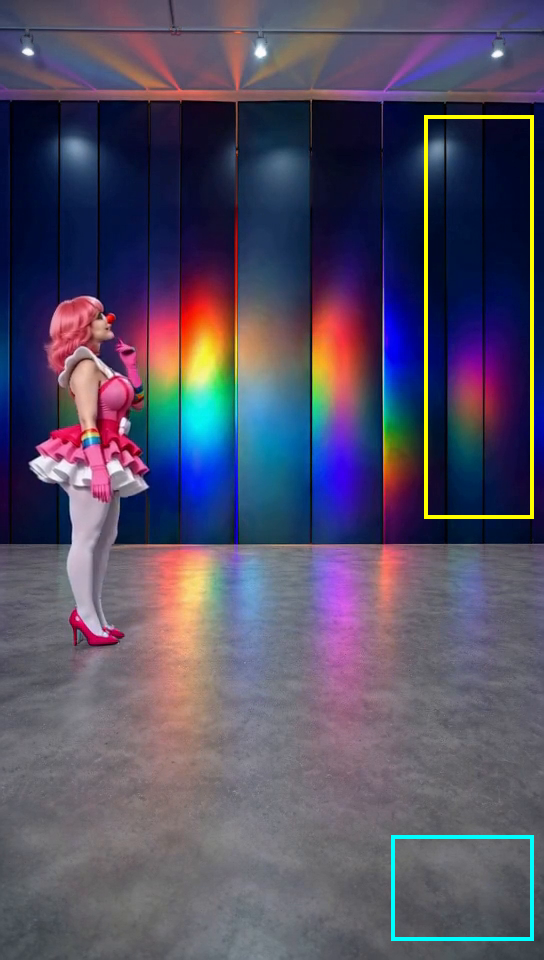

- **Wall colour drift** (yellow patch, the wall on the right behind her): how far its average colour has moved from clip 1. Higher = more colour drift.
- **Floor sharpness** (cyan patch, bottom-right floor): how strong the fine grit and edges are. Clip 1 is 3.3. Higher = more over-sharpened, the "baked" look.
- **Floor blotchiness** (same patch): how much the floor's brightness varies. Clip 1 is 5.0. Higher = blotchier.
- Same workflow, seed and prompts for every chain (clown walk: 8-second clips, 9:16 at 0.5 MP, Clown Context 39 with drop last 17).

An earlier version of these notes averaged the whole frame. That mixed in the woman and let different parts of the frame cancel out, so all tables below have been re-measured on these two patches.

## Prompts used

All prompts use the MiniMax H3 reference-generation format: `subject_definitions`, `summary`, `retention_analysis`, `detailed_description` (with a `[Shot 1]` block), `overall_soundscape` and `non_diegetic_music`. Every prompt holds the camera still and keeps one `[Shot 1]` tag per clip.

**References**
- **Picture 1:** the clown, an adult woman with pink hair, a red clown nose, a rainbow choker, a pink-and-white winged costume with buttons, pink gloves and rainbow cuffs. Every prompt asks to keep her face, hair, costume and figure exactly.
- **Picture 2** (walk scene only): an empty room, the background only, with a colourful paneled backdrop and a polished floor.

**Walk scene** (sections 1–7; 8-second clips, 9:16 at 0.5 MP). One prompt per clip, in the folder `input/prompts/clown_walk`. Each says the camera is stationary, in a locked-off wide shot showing her whole body, with quiet room tone, footsteps and costume rustle, and no music. What she does in each clip:

| Clip | Action |
|---|---|
| 1 | Walks slowly from the centre to the left and stops to look at the backdrop |
| 2 | Turns from the backdrop and wanders back to the centre, glancing at the camera |
| 3 | Strolls to the right, swinging her arms, and does a small twirl |
| 4 | Looks around from the right side, then walks toward the camera |
| 5 | Backs away from the camera, waves, and walks toward the back |
| 6 | Paces slowly along the backdrop from right to left, trailing a hand toward the panels |
| 7 | Walks diagonally toward the front right, stretching her arms |
| 8 | Wanders back to the centre, pausing to adjust her gloves |
| 9 | Walks a slow loop around the centre, looking up at the panels |
| 10 | Returns to the centre, faces the camera and strikes a happy pose |

For the 20-clip walk test, clips 11–20 repeat clips 1–10 (folder `input/prompts/clown_walk20`).

**Studio scene** (sections 8 and 9, and the static test in section 7; 5-second clips). The five grid prompts, folder `input/prompts/frame0_test`. Each one says she "stands still", the camera is locked off and the scene barely moves, with soft, even studio lighting:

| Prompt | Backdrop | Beside her | Framing |
|---|---|---|---|
| 0 control | plain bright red | small brown-and-white beagle | mid shot |
| 1 blue background | plain bright blue | beagle | mid shot |
| 2 child | plain bright red | boy of about six, short brown hair, yellow t-shirt | mid shot |
| 3 close-up | plain bright red | beagle | close-up |
| 4 all three | plain bright blue | boy | close-up |

The five prompts were used once each to make the five frame 0 pictures. **Every studio chain uses the control prompt (0) on every clip**, so only frame 0 changes between rows.

## 1. One clip isn't enough to see anything

Phase 1 swapped a blurred, dark, green or degraded frame 0 into a single clip. Using the Difference blend mode against the clean run, the only change was thin outlines on her from tiny motion differences. No blur, darkness or green spread into the video, and the background was identical.

Degradation builds up over many clips, so single-clip tests can't measure it. **All further tests use 10-clip chains.**

## 2. Frame 0 only matters while sampling, not when decoding

From reading the H3 VAE code:

- Every latent decodes to 4 frames. The first latent of each 17-frame block keeps 1 of them, so latents 0, 5, 10… each end up as one frame.
- The decoder works on 7 latents at a time (one block plus 2 overlap latents), and all 7 affect each other. Latent 0 is only in the first one, so it can only change how about the first 22 frames are decoded.
- The encoder handles each 17-frame block on its own, so nothing carries across blocks when encoding.

The keystone and capstone gains were measured near the end of clip 10, far outside latent 0's reach in the decoder, so they come from sampling.

## 3. The capstone works just as well after it was taken out of the clip

The first Late Lock version wrote the capstone into the clip's last single-frame slot, where it got decoded. The current version only tacks it on during sampling, cuts it off, and puts the real frame 0 back. Same workflow, rerun for 10 clips:

| Run | Wall colour drift | Floor sharpness | Floor blotchiness |
|---|---|---|---|
| No Keystone (baseline) | 3.83 | 29.2 | 10.06 |
| Keystone only (no capstone) | 3.47 | 28.4 | 8.54 |
| Keystone + capstone, old (capstone decoded in the clip) | 2.52 | 22.0 | 6.64 |
| Keystone + capstone, current (capstone cut off) | 2.32 | 21.8 | 7.59 |

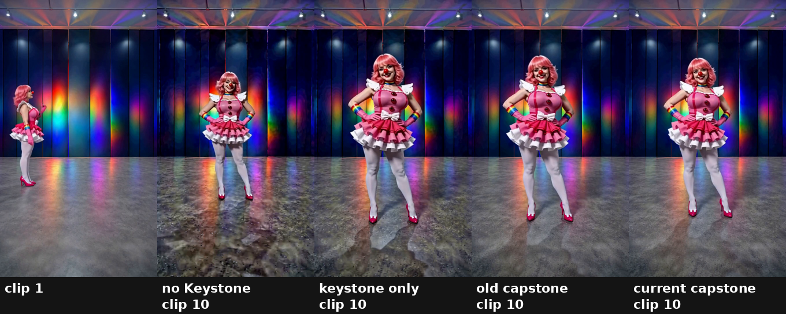

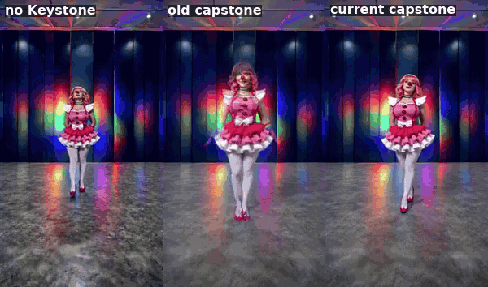

Full-quality video: [capstone_retest_clip10.mp4](media/capstone_retest_clip10.mp4)

Keystone alone only helps a little; adding the capstone is what makes the big difference. Decoding the capstone added nothing. **The current version is confirmed:** less colour drift, a smoother floor and much less over-sharpening, with nothing from clip 1 left in the clips.

## 4. A bad frame 0 makes the chain bake much harder

Phase 1b: the top row of the grid as 10-clip chains. The frame 0 each chain used, on every clip from 2 to 10 (all at full strength):

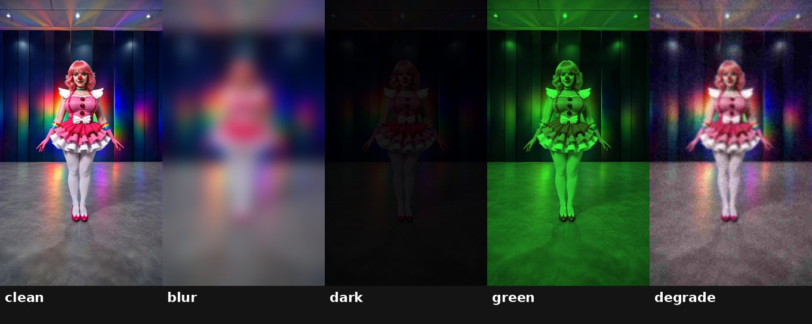

Clip 10 of each:

| Chain (keystone front only) | Wall colour drift | Floor sharpness | Floor blotchiness |
|---|---|---|---|
| No Keystone (baseline) | 3.83 | 29.2 | 10.06 |
| Frame 0 clean | 3.47 | 28.4 | 8.54 |
| Frame 0 blur | 2.64 | 46.6 | 10.14 |
| Frame 0 black (the "dark" effect came out nearly black) | 4.13 | 57.7 | 9.62 |
| Frame 0 green tint | 4.13 | 54.6 | 10.84 |
| Frame 0 degrade | 3.97 | 63.7 | 9.43 |
| Keystone + capstone (clean, for comparison) | 2.32 | 21.8 | 7.59 |

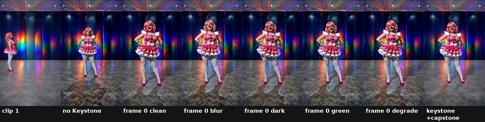

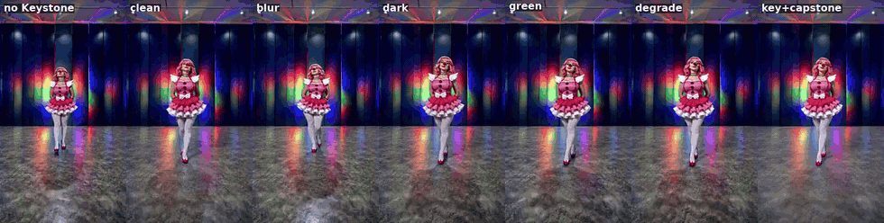

Full-quality video: [frame0_chains_clip10.mp4](media/frame0_chains_clip10.mp4)

- **Sharpness:** this is the clear result. Every bad frame 0 (blur, black, green, degrade) made the floor bake far harder by clip 10: 47–64, against 28 with a clean frame 0. So frame 0's quality matters, and it shows as the over-sharpened look.
- **Colour:** a clean frame 0 on its own only nudged the wall colour (3.47 vs 3.83), and the bad versions landed on both sides of it. Frame 0 alone isn't what holds the colour.
- **The capstone does most of the work:** keystone + capstone has the least wall drift, the least over-sharpening and a smoother floor than keystone alone.

## 5. Moving held frames forward is clean; the drift comes from inside each clip

When Clown Context (or Motion Context) carries the held frames over on a block edge, each single-frame latent lands in a single-frame slot. Nothing is lost or squished in the move. The drift comes from each clip adding small errors while it samples, which are then in the tail that gets carried forward.

## 6. Redrawing the held single-frame latents ("Fresh Singles")

Idea: the held tail carries more than one single-frame latent (with 22 held frames: latents 0 and 5, frames 0 and 17), and each one is a full picture copied forward from the drifted clip. Clown Fresh Singles unlocks just those while sampling, so the model draws fresh ones, and puts the real ones back afterwards. The 4-frame latents stay locked and carry the motion. No Keystone, no capstone. Same walk chain, seed and prompts as everything above.

Two more versions were run with Keystone on: clip 1's clean frame 0 in latent 0, and only latent 5 redrawn (and put back afterwards). One with keystone front only, one with keystone + capstone.

| Run | Wall colour drift | Floor sharpness | Floor blotchiness |
|---|---|---|---|
| No Keystone (baseline) | 3.83 | 29.2 | 10.06 |
| Keystone only | 3.47 | 28.4 | 8.54 |
| Fresh Singles (latents 0 + 5 redrawn) | 3.72 | 19.4 | 9.33 |
| Keystone + Fresh Singles on latent 5 | 2.33 | 31.9 | 9.16 |
| Keystone + capstone | 2.32 | 21.8 | 7.59 |
| **Keystone + capstone + Fresh Singles on latent 5** | **1.40** | **15.9** | **7.26** |

My first number for Fresh Singles (whole-frame drift 3.18) made it look as good as keystone + capstone. Looking at the clips, it isn't: its floor is nearly as blotchy as the no-Keystone run. That's what led to measuring only the two patches above.

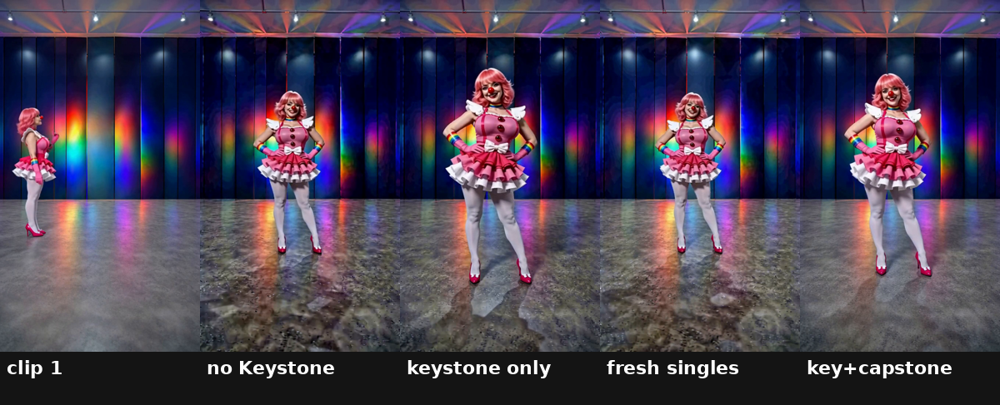

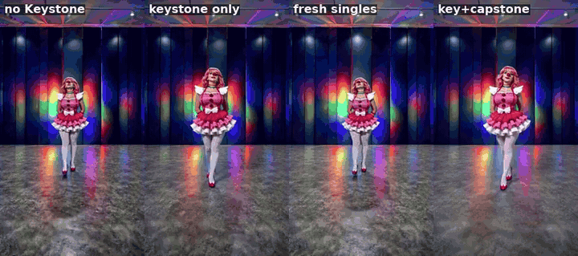

Full-quality video: [fresh_singles_clip10.mp4](media/fresh_singles_clip10.mp4)

The Keystone versions next to keystone only and keystone + capstone:

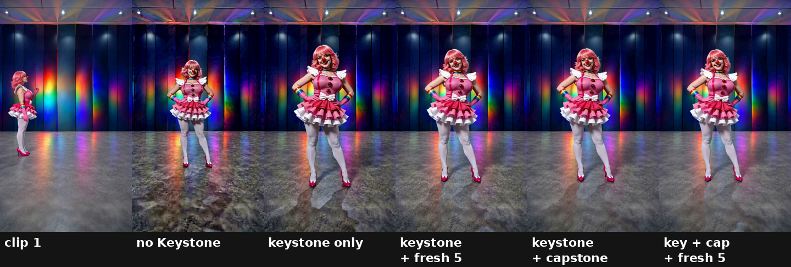

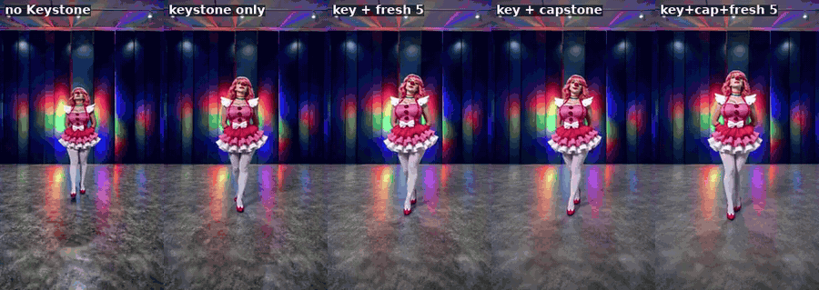

Full-quality video: [fresh5_clip10.mp4](media/fresh5_clip10.mp4)

- **Fresh Singles alone** gave the least floor grit of any run (19.4), but the wall colour barely moved and the floor stayed blotchy.
- **Keystone + Fresh Singles on latent 5** matched keystone + capstone on wall colour (2.33 vs 2.32), the best colour of anything without a capstone, but the floor still baked and stayed blotchy.
- **Keystone + capstone + Fresh Singles on latent 5 is the best so far, on all three patches**: the wall drifted about 40% less than keystone + capstone (1.40 vs 2.32), the floor baked less (15.9 vs 21.8) and it was a little less blotchy (7.26 vs 7.59).
- So latent 5 matters too: copying it forward from the drifted clip adds drift, and redrawing it on top of the keystone and capstone removes some of that.

## 7. New direction: Step Echo (held frames at the same noise level as the new ones)

Reading the H3 code showed something about how held frames are fed in: at every step, the frames Clown Context holds go to the model almost clean (0.999), even on step 1 when the new frames are still pure noise. The idea: the drift may come from the model copying finished held frames that aren't forming along with the noise around them.

**Clown Step Echo** (private pack) saves the clip's latent at every one of the 8 steps. On the next clip, at each step the held frames are swapped for the same frames at the same step of the last clip, so they sit at the same noise level as the new frames and "grow" with them, like the overlap in context windows. The real held latents are put back after sampling, so the join lines up.

Prior work: the closest is Lumifel on Banodoco (20 Aug 2026), who added the sampler's current noise to the held context each step, fading it out near the join. He said it removed the burn-in and artifacts past 60 s but didn't fully fix the colour drift. Step Echo uses the last clip's real in-between latents instead of fresh noise on finished frames. Nothing found that replays the saved steps.

### How the Step Echo runs are measured

Step Echo changes the scene more than the earlier runs: the light streaks on the wall move around, the framing changes, and her reflection runs through the bottom-right floor patch. So the two patches from the top of this page don't work here. The wall patch was measuring where the streaks happen to be, not colour drift, and the floor patch was picking up her reflection. My first numbers for these runs were wrong because of that. All the runs below (old ones included, for comparison) were re-measured on patches the scene changes don't touch:

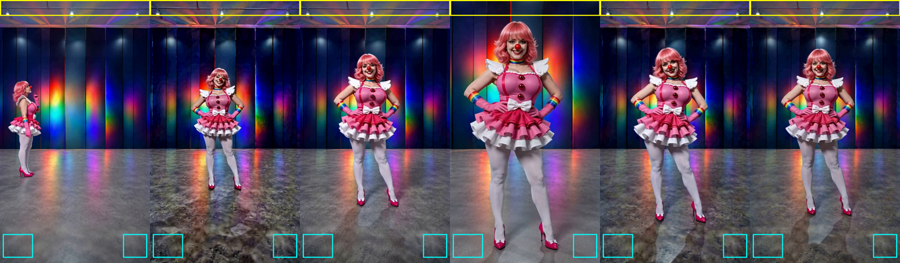

- **Ceiling brightness / colour drift** (yellow, the ceiling band along the top): the same structure in every run, so it shows the overall darkening and colour shift. Not usable for plain Step Echo, which zoomed in so far the ceiling is out of shot.
- **Floor blotches** (cyan, two bottom corners clear of her and her reflection): how much the floor's brightness varies in large patches. Clip 1 is 4.5.
- **Floor grit**: how strong the fine grain is (the baked look). Clip 1 is 1.25.
- **Join jump**: how big the change is from the last held frame to the first new frame, compared with normal frame-to-frame motion in the same clip (averaged over clips 2–10; 1.0 = no jump). For the earlier chains only clip 10 was available here.

| Run (clip 10) | Ceiling colour drift | Ceiling brightness | Floor blotches | Floor grit | Join jump |
|---|---|---|---|---|---|
| Clip 1 | 0 | 0 | 4.47 | 1.25 | |
| No Keystone | 6.17 | −5.64 | 7.21 | 4.92 | 1.4 |
| Keystone + capstone | 3.06 | −2.75 | 5.88 | 2.61 | 1.0 |
| Keystone + capstone + Fresh Singles on latent 5 | 1.69 | −1.42 | 5.42 | 2.39 | 1.8 |
| Step Echo (all held frames echoed) | n/a | n/a | **2.08** | **1.50** | 4.3 (worst 34) |
| Step Echo, frame 0 locked + FreeNoise | 5.52 | −5.09 | 5.98 | 3.73 | 2.5 (worst 5.6) |
| Step Echo, latents 0 + 5 locked + FreeNoise | 6.25 | −4.41 | 5.02 | 2.62 | 1.5 (worst 2.1) |

### First run: every held frame echoed

The plain walk chain (no Keystone), Step Echo from shot 3 (clip 1 was rendered before Step Echo existed, so shot 2 only recorded).

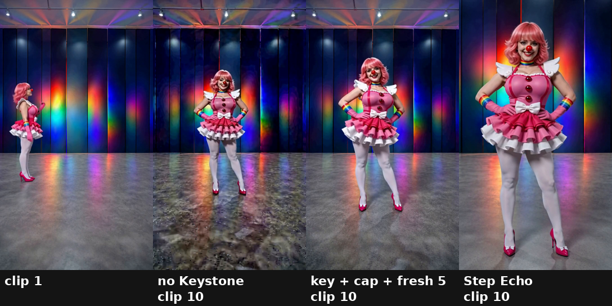

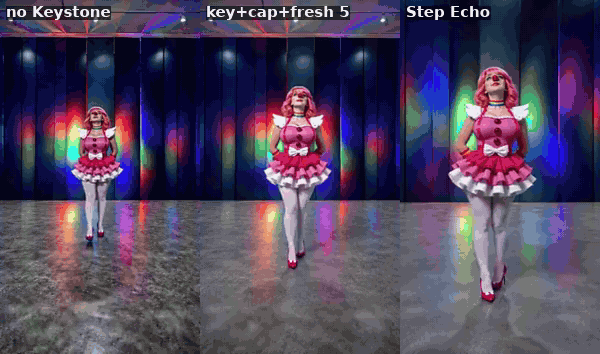

Full-quality video: [step_echo_clip10.mp4](media/step_echo_clip10.mp4)

Every clip of the Step Echo chain, about 20 frames from the end:

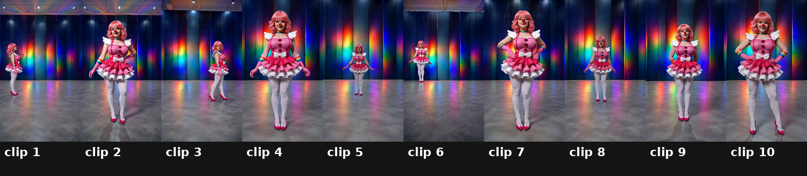

- **No degradation.** The floor is the cleanest of any chain by clip 10 (blotches 2.08, grit 1.50, about the same as clip 1). It looks like a fresh generation.
- **But it doesn't hold the scene.** The framing jumps in and out from clip to clip, the ceiling lights come and go, and by clip 10 the wall behind her reads more like a door. The joins jump too (4.3× normal motion on average, 34× at worst).
- Why: on H3's schedule the saved steps sit at noise levels of about 1.0, 0.99, 0.98, 0.96, 0.92, 0.86, 0.72 and 0.42, so for most of the render the echoed held frames are still mostly noise. The model can't copy them, which stops the baking, but it also has almost nothing to hold the scene to.
- This points to the drift coming from the model copying finished held frames.

### Second run: frame 0 of the held context locked, FreeNoise on

Same chain, but the first held latent (frame 0 of the held context, which comes from the last clip) stays locked and finished as an anchor, and only latents 1–6 are echoed. With a new noise option, FreeNoise, on from shot 3: the held frames get the last clip's exact starting noise, so the noise print runs straight across the join, and the new frames reuse that noise reshuffled instead of fresh random noise.

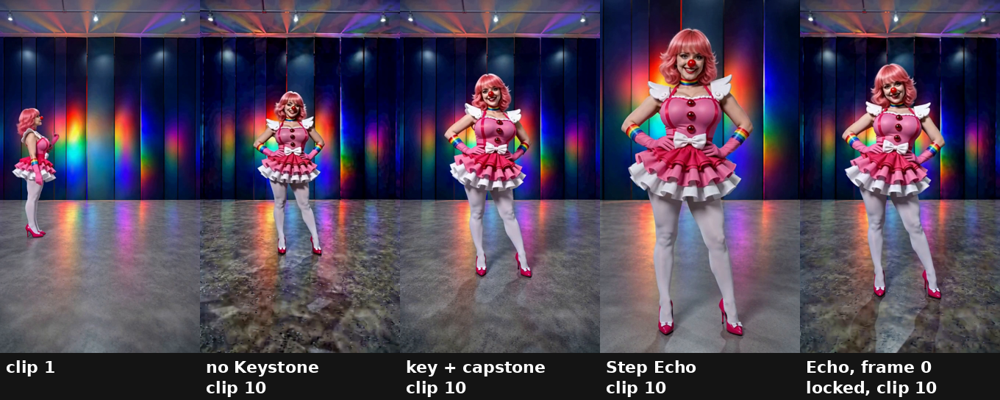

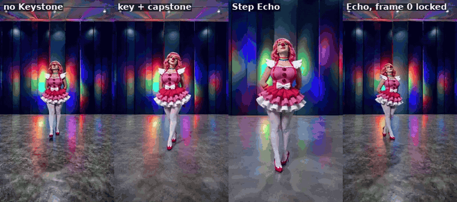

Full-quality video: [step_echo_f0_clip10.mp4](media/step_echo_f0_clip10.mp4)

Every clip of the chain, about 20 frames from the end:

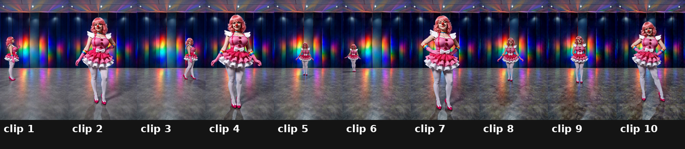

- **The scene holds again.** The wall, the ceiling lights and the room stay the same from clip to clip. One finished first frame was enough to anchor it, like an image-to-video start.
- **But the motion between clips isn't connected.** The movement doesn't carry across the joins (2.5× normal motion on average): each clip continues from a still picture, not from the motion of the last one. Only frame 0 is solid; the frames that carry the movement are still mostly noise for most of the render.
- **About half the degradation came back.** Floor blotches 5.98 and grit 3.73 sit between keystone + capstone and the plain chain, and the picture got darker clip by clip (ceiling −5.09, nearly as dark as the plain chain). By eye it also lands about halfway between keystone + capstone and the plain chain.
- Why: the locked frame 0 is a finished frame from the last clip, drift included, and the model follows it closely, so its colour and look get passed forward with nothing to pull them back. It's the "bad frame 0" effect from section 4, milder.

### Third run: latents 0 and 5 locked, FreeNoise on

Both held single-frame latents locked and finished (latents 0 and 5: frames 0 and 17 of the held context, from the last clip), the 4-frame latents echoed, FreeNoise on from shot 3. No Keystone, no capstone, on purpose, to see what Step Echo does on its own.

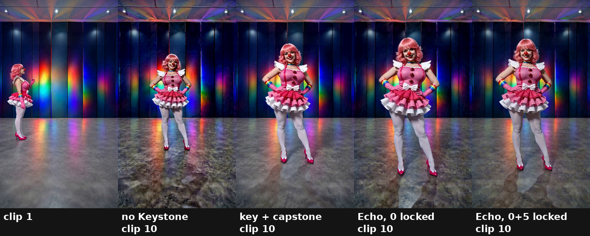

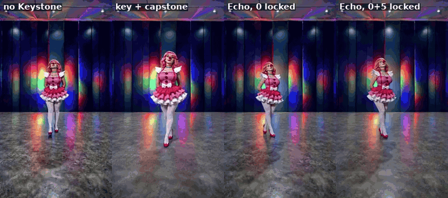

Full-quality video: [step_echo_05_clip10.mp4](media/step_echo_05_clip10.mp4)

Every clip of the chain, about 20 frames from the end:

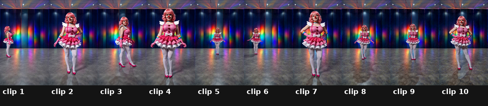

- **The scene holds**, like the frame-0 run.
- **The joins are much smoother**: 1.5× normal motion on average and 2.1× at worst, close to a normal chain. Two finished pictures 17 frames apart carry the motion across the join.
- **The floor is about as clean as keystone + capstone** (blotches 5.02, grit 2.62 vs 5.88 / 2.61), without a keystone or capstone.
- **The colour still drifts darker** (ceiling −4.41 vs −2.75 for keystone + capstone). Nothing pulls the colour back toward clip 1, so the locked frames pass the last clip's colour forward.
- So far: locking the single-frame latents and echoing the 4-frame ones keeps the scene and the motion while cutting the baking. Colour is what's left.

### Fourth and fifth runs: context noise, after Lumifel

Lumifel (Banodoco, Aug 2026) gave the held context part of the sampler's current noise at every step, fading to none at the end of the context so the join stays clean. He reported no burn-in up to about 60 s, but the colour still drifted warmer. These runs test whether a clean frame 0 (and then the capstone) takes care of the colour he had left. Asked directly (2 Nov 2026), Lumifel said motion was pretty good with his method and the colour shift was the only issue.

How it's done here (node: Clown Context Noise): H3 supports partial masks, where a mask value m puts a held latent at m × the current noise level and the model is told so. The held latents after latent 0 ramp from 0.8 at the start of the held part down to 0 at the join (latents 1–5: 0.8, 0.64, 0.48, 0.32, 0.16; latent 6 stays locked). Latent 0 is clip 1's clean frame 0 (Keystone), locked. The real held latents are put back after sampling, so the join lines up. Same walk chain, seed and prompts as everything above.

| Run (clip 10) | Ceiling colour drift | Ceiling brightness | Floor blotches | Floor grit | Join jump |
|---|---|---|---|---|---|
| Clip 1 | 0 | 0 | 4.47 | 1.25 | |
| No Keystone | 6.17 | −5.64 | 7.21 | 4.92 | 1.4 |
| Keystone only | 5.18 | −4.71 | 7.61 | 4.27 | |
| Keystone + capstone | 3.06 | −2.75 | 5.88 | 2.61 | 1.0 |
| Keystone + capstone + Fresh Singles on latent 5 | 1.69 | −1.42 | 5.42 | 2.39 | 1.8 |
| Keystone + context noise | 3.53 | −3.47 | 5.75 | 2.38 | 1.3 (worst 2.0) |
| **Keystone + capstone + context noise** | **1.59** | −1.57 | **4.93** | **1.73** | 1.4 (worst 1.9) |

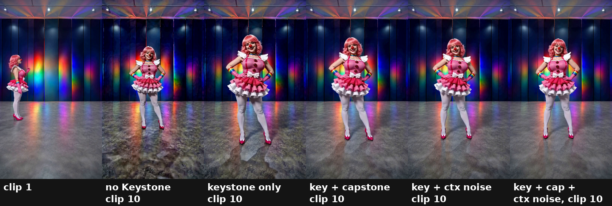

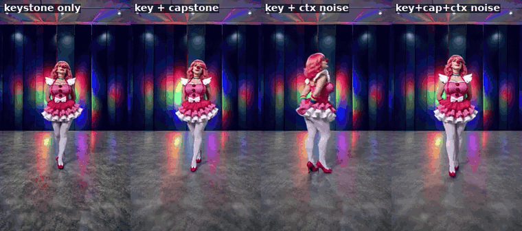

Full-quality video: [ctxnoise_clip10.mp4](media/ctxnoise_clip10.mp4)

Every clip, about 20 frames from the end. Keystone + context noise:

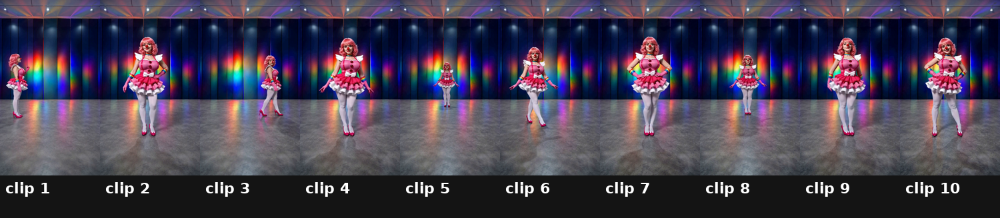

Keystone + capstone + context noise:

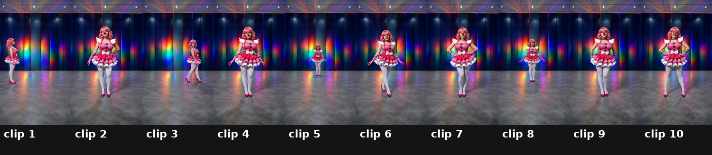

- **By eye: no visible degradation by clip 10.** Watching the clips side by side, the keystone + capstone + context noise chain looks as clean at clip 10 as at the start.
- **Keystone + capstone + context noise is the best run so far on every measure.** The floor is nearly back to clip 1 (blotches 4.93 vs 4.47, grit 1.73 vs 1.25), and the colour drift is the lowest of any run (1.59).
- **Context noise with only the keystone already matches keystone + capstone**: about the same floor (slightly less grit) and close on colour, with no capstone.
- **The scene and the motion hold.** Unlike Step Echo, the held frames still carry the picture, just not fully clean, so the room, the framing and the motion across the joins stay normal (join jump 1.3–1.4, the same as a plain chain).
- **The colour still drifts a little** (slightly darker by clip 10) without the capstone. With it, colour is the best of anything tested.
- It's one 10-clip chain (about 73 s) on one moving shot. Next checks: a longer chain (20+ clips), and a static shot, where drift shows worst.

### Longer and static tests: keystone + capstone + context noise

The best setup (keystone + Late Lock capstone + context noise) run for 20 clips, on the walk and on a locked-off static shot.

**Walk, 20 clips (about 2½ minutes).** The same chain as above, continued from clip 11 to clip 20. Clips 11–20 repeat the 10 walk prompts.

| Walk | Ceiling colour drift | Ceiling brightness | Floor blotches | Floor grit |
|---|---|---|---|---|
| Clip 1 | 0 | 0 | 4.47 | 1.25 |
| No Keystone, clip 10 | 6.17 | −5.64 | 7.21 | 4.92 |
| Keystone + capstone, clip 10 | 3.06 | −2.75 | 5.88 | 2.61 |
| Key + cap + context noise, clip 5 | 0.97 | −0.95 | 4.82 | 1.39 |
| Key + cap + context noise, clip 10 | 1.59 | −1.57 | 4.93 | 1.73 |
| Key + cap + context noise, clip 15 | 1.07 | −1.05 | 4.90 | 1.42 |
| **Key + cap + context noise, clip 20** | **1.67** | −1.66 | **5.12** | **1.89** |

Join jump over clips 11–20: 1.14× normal motion on average, 1.90× at worst.

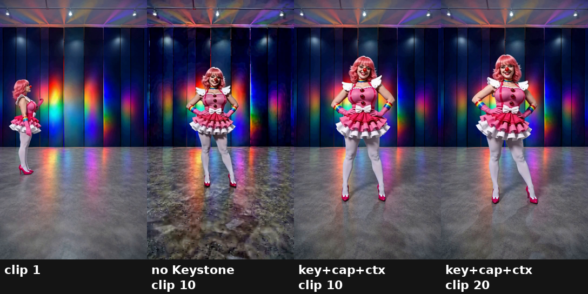

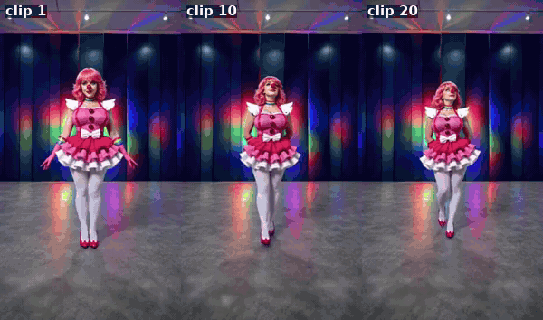

Full-quality video: [long_walk.mp4](media/long_walk.mp4)

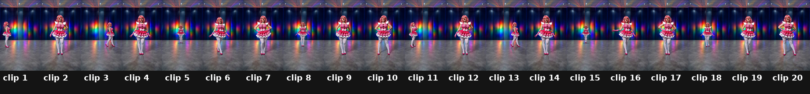

- **No build-up from clip 10 to clip 20.** Colour drift stays around 1–1.7 the whole way and the floor stays near clip 1. It goes up and down a little from clip to clip instead of climbing. The joins stay smooth.

**Static studio shot, 20 clips (about 1½ minutes).** The red studio backdrop with a locked-off camera from section 8, control prompt on every clip, 5-second clips. Measured on the two top corners of the backdrop (section 8).

| Static | Backdrop colour drift | Backdrop brightness | Backdrop grit |
|---|---|---|---|
| Clip 1 | 0 | 0 | 0.31 |
| Keystone only, clip 10 (section 8) | 6.90 | −4.57 | 0.52 |
| Key + cap + context noise, clip 5 | 3.92 | −1.96 | 0.31 |
| Key + cap + context noise, clip 10 | 5.32 | −2.85 | 0.35 |
| Key + cap + context noise, clip 15 | 7.40 | −4.04 | 0.42 |
| Key + cap + context noise, clip 18 | 9.2 | −5.0 | 0.48 |
| Key + cap + context noise, clip 20 | 2.97 | −1.38 | 0.33 |

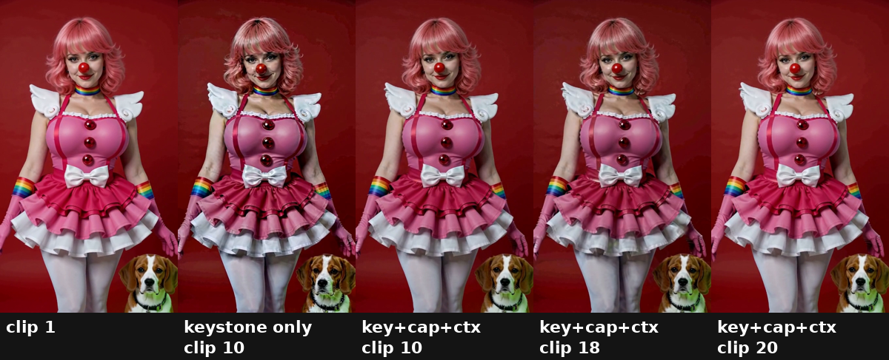

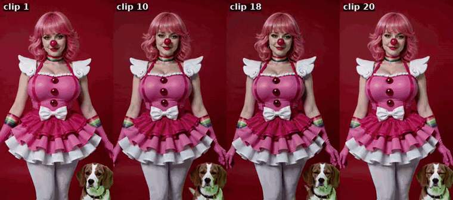

Full-quality video: [long_static.mp4](media/long_static.mp4)

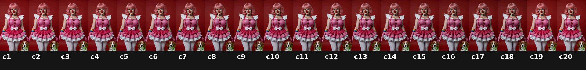

- **The texture stays clean.** The backdrop grit barely moves (0.31 → 0.35 at clip 10, 0.48 at its worst), less than keystone alone (0.52 at clip 10). No baking.
- **The colour still drifts on the static shot.** The backdrop gets darker and a deeper, duller red, slowly and steadily, from clip 2 to clip 18 (brightness −5 by clip 18). It's slower than keystone alone (−2.85 vs −4.57 at clip 10), but it doesn't stop.
- **The capstone pulls the end of every clip back.** Within each clip, the last ~15 frames brighten back toward clip 1 (the backdrop jumps from about 97 back to 116 in red at the end of clip 18). Those end frames are the ones Clown Context drops when it carries the clip forward, so the next clip still continues from the darker middle. In a stitched video they're replaced by the next clip, so it's mostly hidden, but it means the capstone's pull doesn't carry into the next clip on a static shot.
- **At clip 19 the chain recovered by itself.** Clip 19 starts dark and brightens over its 5 seconds back to about clip 1's level, and clip 20 stays there. It happened once; it's not clear yet whether it repeats.
- So: on a moving shot this setup holds for 20 clips with no build-up. On a locked-off shot the texture holds but the colour still drifts slowly, and the capstone's correction gets dropped with the clip's tail. Next idea: carry the corrected end forward, or hold the context from earlier in the clip, so the capstone's pull is kept.

## 8. The full grid: frame 0 content × frame 0 quality (studio scene)

The grid from the proposal, run as 25 ten-clip chains in the studio scene the grid pictures came from: a locked-off camera, a plain red backdrop, the clown with a beagle. Clip 1 is the shared studio control clip. Shots 2–10 use the **control prompt** and that chain's frame 0 through Keystone (front only, no capstone, no context noise). 5-second clips.

- **Rows** (frame 0 content, more and more different from the video): control, blue background, child instead of dog, close-up, all three.
- **Columns** (frame 0 quality, all at full strength): clean, blur, black, green tint, degrade.

The five frame 0 pictures (before the effects):

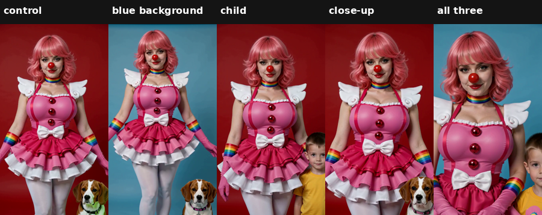

**How it's measured:** the backdrop is plain red, so the two top corners of the backdrop (yellow), which she and the dog never cover, are used for everything:

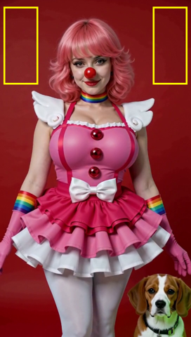

- **Colour drift:** how far the backdrop's average colour has moved from clip 1 (higher = more drift). The table also shows the brightness change.
- **Grit:** fine grain on the backdrop, which should be smooth. Clip 1 is 0.31. Higher = more baked.
- Clip 10, averaged over 10 frames about 20 frames from the end, against clip 1 at the same place.

**Colour drift at clip 10** (brightness change in brackets):

| Frame 0 content \ quality | clean | blur | black | green | degrade |
|---|---|---|---|---|---|
| control | **6.90** (−4.6) | 8.02 (−5.3) | 8.18 (−5.3) | 8.02 (−5.2) | 7.96 (−5.9) |
| blue background | **7.22** (−4.8) | 8.03 (−5.3) | 7.46 (−5.0) | 9.01 (−5.4) | 7.08 (−5.0) |
| child | **6.86** (−4.6) | 8.85 (−5.6) | 8.15 (−4.9) | 6.95 (−4.2) | 7.76 (−5.4) |
| close-up | **7.24** (−4.6) | 8.63 (−5.7) | 8.03 (−4.7) | 8.65 (−4.9) | 8.01 (−5.4) |
| all three | **6.15** (−4.0) | 7.75 (−4.9) | 6.79 (−4.1) | 8.53 (−5.1) | 7.61 (−5.1) |

**Grit at clip 10** (clip 1 = 0.31):

| Frame 0 content \ quality | clean | blur | black | green | degrade |
|---|---|---|---|---|---|
| control | 0.52 | 0.56 | 0.69 | 0.80 | 0.52 |
| blue background | 0.67 | 0.71 | 0.61 | 0.64 | 0.58 |
| child | 0.49 | 0.58 | 0.55 | 0.61 | 0.46 |
| close-up | 0.49 | 0.56 | 0.52 | 0.61 | 0.46 |
| all three | 0.54 | 0.61 | 0.57 | 0.57 | 0.51 |

Clip 10 of every chain, about 20 frames from the end (clip 1 in the first column):

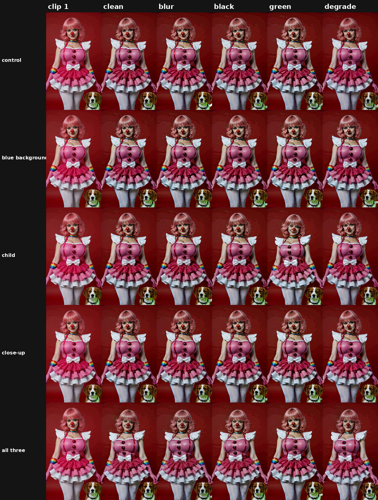

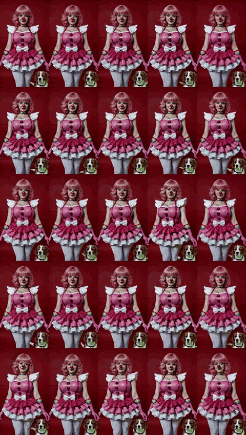

Full-quality video: [grid_clip10.mp4](media/grid_clip10.mp4)

- **The content of frame 0 doesn't carry through.** None of the blue background, the child or the close-up shows up by clip 10. Every chain is the same red studio with the dog, mid shot. The prompt and the held frames win over a mismatched frame 0. The content rows only change the numbers a little, with no pattern from "close to the video" to "far from it".
- **The quality of frame 0 does matter.** In every row, the clean frame 0 drifts least (6.2–7.2). Blur, black, green and degrade all drift more (6.8–9.0), and the green tint chains have the most grit. It's the same direction as the walk chains in section 4, just smaller.
- **Static shots drift mostly in colour.** Every chain, clean included, got darker (about −4 to −6) and the red backdrop went deeper and a bit duller. The grit only went from 0.31 to about 0.5–0.8, much less than the floor baking in the walk scene. So on this locked-off shot, degradation is mainly darkening, not texture.
- All 25 chains use keystone only. They show how much frame 0 alone does on a static shot; the best setup from section 7 (keystone + capstone + context noise) is being tested on this same studio scene for 20 clips.

## 9. Grid 2: methods × frame 0 content (studio scene, 20 clips)

The same studio scene and frame 0 pictures as section 8, all clean, with the methods as columns. 12 chains, 20 clips each (about 1½ minutes). Baseline and context noise only don't use frame 0, so they ran once and are repeated in every row.

- **Rows:** the five clean frame 0 pictures from section 8 (control, blue background, child, close-up, all three). The keystone and the capstone both come from that row's picture.
- **Columns:** baseline, keystone + capstone, context noise only, context noise + keystone + capstone.
- Measured the same way as section 8 (backdrop top corners, about 20 frames from the end of the clip).

Clip 20 of every chain, about 20 frames from the end (clip 1 in the first column):

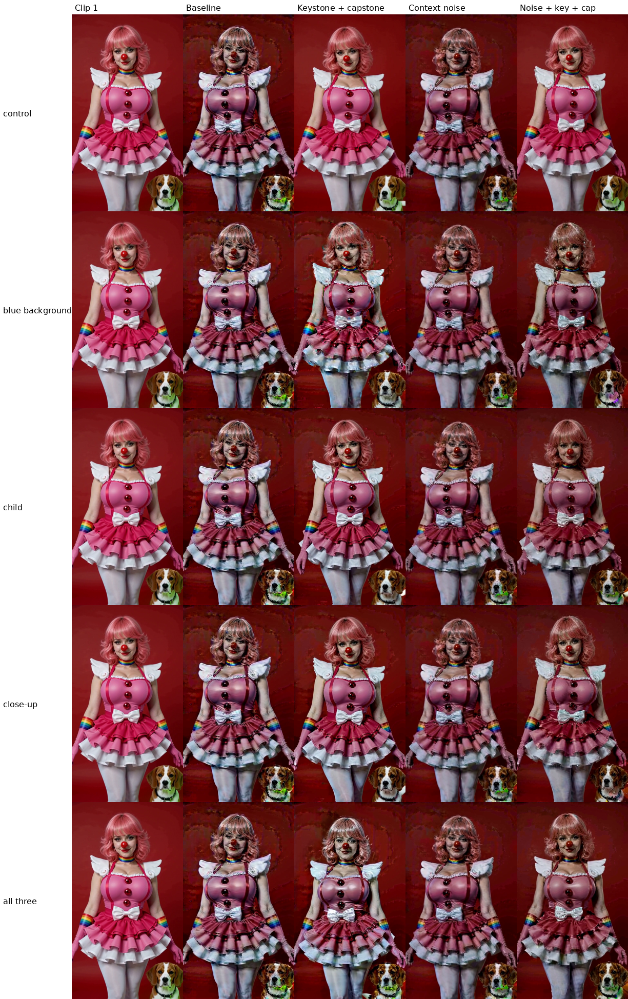

**Colour drift at clip 20** (brightness change in brackets; clip 1 = 0):

| Frame 0 \ method | Baseline | Keystone + capstone | Context noise | Noise + key + cap |
|---|---|---|---|---|
| control | 10.8 (−6.7) | **2.9 (−1.7)** | 13.1 (−8.3) | 4.1 (−3.3) |
| blue background | 10.8 (−6.7) | 8.0 (−5.2) | 13.1 (−8.3) | 14.3 (−8.6) |
| child | 10.8 (−6.7) | 8.9 (−5.7) | 13.1 (−8.3) | 16.1 (−8.7) |
| close-up | 10.8 (−6.7) | 8.5 (−5.6) | 13.1 (−8.3) | 16.2 (−8.7) |
| all three | 10.8 (−6.7) | 8.4 (−5.7) | 13.1 (−8.3) | 14.0 (−8.4) |

**Grit at clip 20** (clip 1 = 0.31):

| Frame 0 \ method | Baseline | Keystone + capstone | Context noise | Noise + key + cap |
|---|---|---|---|---|
| control | 1.94 | **0.28** | 1.02 | **0.30** |
| blue background | 1.94 | 1.88 | 1.02 | 0.65 |
| child | 1.94 | 1.00 | 1.02 | 0.65 |
| close-up | 1.94 | 0.99 | 1.02 | 0.69 |
| all three | 1.94 | 1.25 | 1.02 | 0.64 |

Clip 10 and clip 15 numbers are in the same pattern: at clip 10 the colour drift is 6–7 for baseline and keystone + capstone, and 8–10 for the two context noise columns.

**Backdrop brightness clip by clip** (control row):

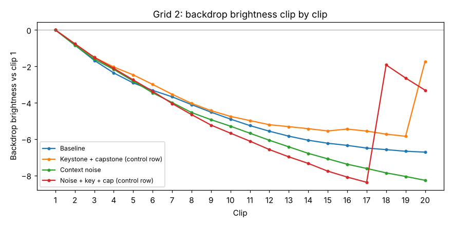

- **Every method still darkens on this static shot.** Clip by clip the backdrop gets steadily darker in all four columns. None of them stops it.
- **Context noise makes the colour worse and the texture better here.** Context noise alone ends darker than baseline (−8.3 vs −6.7) but with about half the grit (1.02 vs 1.94). Adding it to keystone + capstone does the same: the most darkening of any column, and the least grit. On the walk it helped both; on this static shot it trades colour for texture.
- **Keystone + capstone is the best for colour** in every row (about 8–9 vs 10.8 for baseline), but its grit varies a lot by row (1.0 to 1.9).
- **The control row recovered by itself near the end, in both keystone columns.** Keystone + capstone sat at −5.8 through clip 19, then jumped back to −1.7 at clip 20. Noise + key + cap fell to −8.4 by clip 17, then jumped back to −1.9 at clip 18. The backdrop grit also went back to clip 1's level. It's the same thing as the clip 19 recovery in the static test (section 7), which also used the control picture.
- **The other rows never recovered.** Their frame 0 pictures don't quite match the video (blue background, child, close-up), so it looks like the reset only happens when the keystone and capstone match the scene closely. That's also why the control row looks best in the still above: it has just reset, not because it never drifted.
- So on a locked-off shot, context noise is a texture fix, not a colour fix. The colour still needs something else: a matching keystone/capstone (and whatever triggers the reset), a join correction like NikoDemon80's Join Match, or colour matching.

## 10. Beach benchmark: a 50-clip chain through four scenes

A woman running on a beach is a hard benchmark (BittiAI's suggestion): still and moving parts in the background, bare skin, and constant motion, which usually start breaking after about a minute. Here it's extended into four scenes, 50 clips of 8 seconds (about 5 min 20 s stitched), rendered twice:

- **Best setup:** Geiru Context (39, drop_last 17) + Context Noise (0.8) + Keystone (keystone front + capstone back) + Late Lock (capstone from step 5).
- **Plain chain:** the same Context settings, nothing else.

Both chains share clip 1 and use the same prompts, seed and settings. Reference: the sundress clown character sheet.

| Clips | Scene | Best setup |
|---|---|---|
| 1–20 | Running along the beach, camera tracking | Keystone + capstone from clip 1, context noise |
| 21–22 | Slows down and sits at a beach café (21), settles in (22) | Keystone off, context noise on |
| 23–30 | Sitting at the café table, still camera | Keystone + capstone from **clip 22**, the first clip that's fully the café |
| 31–40 | Gets up and walks through a changing town: boardwalk, steps, streets, plaza, market, park, avenue, garden gate | Keystone off, context noise on |
| 41–42 | Walks onto a garden patio and sits on a wicker sofa | Keystone off, context noise on |
| 43–50 | Sitting on the sofa, still camera | Keystone + capstone from **clip 42** |

The keystone source is the first clip that fully shows each new still scene, not the transition clip into it, so the anchor matches the scene (grid 2, section 9, showed a mismatched frame 0 drifts more).

**How it's measured:** the four corners of the frame (top: sky / umbrella / roses; bottom: sand / deck / paving), about 20 frames from the end of each clip. Colour drift and brightness are measured against the start of each still section: clip 1 for the beach, clip 22 for the café, clip 42 for the garden, each chain against its own clip. Grit is fine grain in the corners. The beach is a moving shot, so its corners change content a bit from clip to clip; those numbers are rougher than the café and garden ones.

The end of each section (best setup on top, plain chain below):

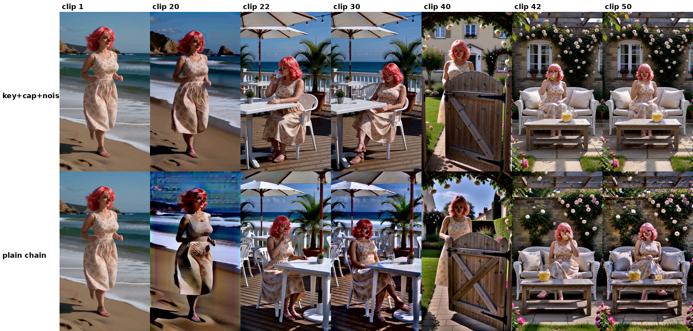

Every clip: [best setup](media/beach_best_every_clip.png), [plain chain](media/beach_base_every_clip.png).

| | Best setup | Plain chain |
|---|---|---|
| **Beach, clip 20** (vs clip 1): sky drift / brightness | 15.5 / −12.3 | 23.4 / −20.3 |
| Beach, clip 20: sand drift / brightness | 12.6 / −12.4 | 18.1 / −17.8 |
| Beach, clip 20: grit (clip 1 = 2.16) | 2.68 | 5.65 |
| **Café, clip 30** (vs clip 22): top / bottom brightness | −1.1 / −4.6 | −5.5 / −5.8 |
| **Garden, clip 50** (vs clip 42): top / bottom brightness | −0.2 / −0.3 | −1.3 / −3.9 |
| Garden, clip 50: grit (clip 42: 11.0 / 11.6) | 11.2 | 13.6 |

- **Beach: the plain chain falls apart; the best setup holds.** By clip 20 the plain chain's sky has turned into glitchy streaks, the skin is burnt and the sand is more than twice as gritty. The best setup is still clean at clip 20, but it does get darker (about −12), steadily over the first 10 clips and then levelling off.
- **Café and garden (still camera): the best setup barely drifts.** With the keystone and capstone from the first clip of the scene, the garden is flat for 8 clips (−0.3) and the café drifts only a little. The plain chain keeps darkening in both.
- **Scene changes reset the drift on their own.** At the café the plain chain cleaned itself up, so protection isn't needed around cuts and new environments, only while the scene stays the same.
- **The town walk held up in both,** since the background keeps changing; nothing gets copied for long enough to bake.
- Joins stay smooth in both chains (checked by eye on the stitched videos).

So this is a "switch it on while the scene stays the same" tool: on a long single-scene stretch it's the difference between falling apart and holding, and around cuts it isn't needed. That's what Geiru Context's `degradation_protection` switch is for.

## 11. Context noise sweep: fade × strength (beach run, 20 clips)

The same beach run as section 10 (same prompts, seed and clip 1). Clips 1–9: running on the beach, keystone + capstone + context noise. Clip 10: she leaves the beach into a pine forest, then walks into a new place every clip up to clip 20 (keystone and capstone off from clip 10, context noise on). Each run changes only the context noise fade and strength:

- **linear:** the held latents ramp from the strength down to 0 at the join.
- **ease:** the same, curved, so the noise drops off faster.
- **ethanfel:** ethanfel's drift_control recipe: full strength, a 4-latent taper to 0 at the join, and at every step the values are scaled by next noise level ÷ current noise level. With the 5 held latents here, its taper is the same as linear, so the per-step scaling is the real difference.

Strengths 1, 0.8, 0.6 and 0.4 (linear 0.4 only; ease and ethanfel at 0.4 were dropped once 0.6 and linear 0.4 were clearly worse). 11 runs plus the plain chain (no keystone, capstone or noise). The 0.8 linear and plain runs reuse section 10's clips 2–9.

**Measured:** colour change against clip 1 in the four corners (average of sky and sand), and corner grit, on the beach (clips 3, 5, 7, 9); full-frame grit after the scene changes (clips 12, 16, 20). Lower is better.

| Run | Beach colour change (avg, clips 3–9) | Beach colour change, clip 9 | Beach grit (avg; clip 1 = 2.16) | Grit after scene changes (avg) |
|---|---|---|---|---|
| **linear 1** | **8.4** | **8.4** | **2.33** | 6.18 |
| ease 1 | 8.5 | 9.8 | **2.33** | 6.08 |
| ease 0.8 | 8.5 | 10.0 | 2.45 | 6.26 |
| linear 0.8 (old default) | 8.9 | 10.3 | 2.54 | 5.97 |
| ethanfel 0.8 | 9.6 | 9.7 | 2.50 | 6.14 |
| ethanfel 1 | 9.9 | 10.3 | 2.51 | 6.25 |
| linear 0.6 | 9.1 | 10.2 | 2.66 | 6.25 |
| ease 0.6 | 9.0 | 10.5 | 2.66 | 6.38 |
| ethanfel 0.6 | 10.4 | 11.2 | 2.50 | 6.02 |
| linear 0.4 | 8.9 | 10.6 | 2.84 | 6.43 |
| plain chain | 9.9 | **13.0** | 2.47 (2.83 at clip 9) | 6.46 |

Clip 9 (the end of the beach part) for every run, next to clip 1:

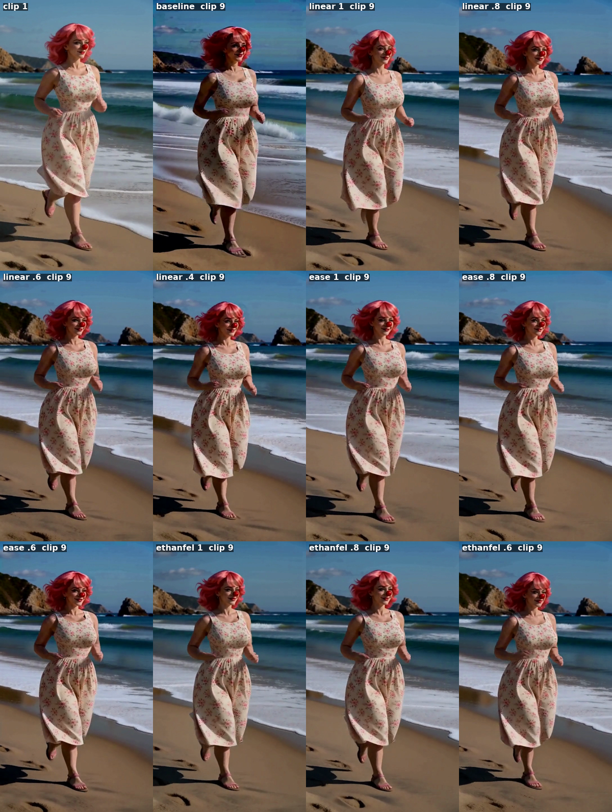

- **Strength matters more than fade.** At 1 and 0.8 the grit stays close to clip 1; at 0.6 and 0.4 it climbs back up to the plain chain's level by clip 9.
- **Strength 1 is best.** Linear 1 has the least colour change and stays the cleanest; ease 1 is about the same. Both beat the old default (linear 0.8).
- **ethanfel's per-step scaling didn't help here.** At the same strength it drifted a bit more than linear and ease. (Here it runs on top of keystone + capstone, which isn't what it was designed for.)
- **The plain chain drifts steadily** (colour change 6.4 → 8.5 → 11.8 → 13.0 over clips 3–9); the noise runs level off around 8–10.
- **After the scene changes, the settings barely matter.** Full-frame grit is 6.0–6.5 in every run, the plain chain included: each new place resets the drift (as in section 10).

One seed, and the beach is a moving shot, so the corners don't show exactly the same content in every run: differences of about 1 are within noise. Linear 1 and ease 1 vs the plain chain is a real gap; linear 1 vs ease 1 isn't.

**Change:** the context noise strength default is now **1** (was 0.8) in Geiru Context Noise and Geiru Hybrid Windows. Linear stays the default fade.

## Running now

Anti-Burn LoRA at 0.6 on the 20-clip sweep run, linear 1 ([test 11](frame0_influence_test.md)), then the same run branched at clip 9 into one continuous take through changing worlds ([test 12](frame0_influence_test.md)).
