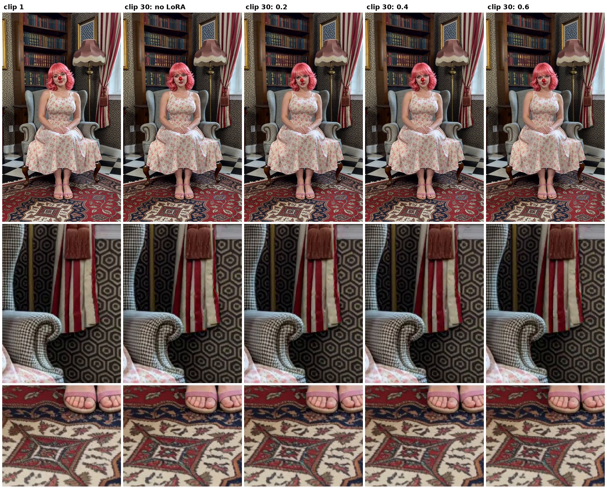

# Test 13: Anti-Burn LoRA strength on a static scene (30 clips)

Does the [H3 Anti-Burn LoRA](https://huggingface.co/Imagineer13/H3-Anti-Burn-LoRA) smooth fine texture, and what strength is best? A static scene full of fine patterns, so any smoothing or burn is easy to see, and the content doesn't change from clip to clip (so colour and texture changes really are drift, not the camera showing something new).

## Setup

- **Scene:** the sundress clown sits still in a houndstooth armchair in a small parlor full of fine patterns: black-and-white hexagon wallpaper with gold pinstripes, a checkerboard tile floor, a detailed Persian rug, a bookshelf packed with books, a tile mosaic, striped curtains. Locked-off camera, steady light. She only does small things (blinks, breathes, glances, smooths her skirt). Prompts: [prompts/static_chair](prompts/static_chair).
- **Chain:** 30 clips of 8 s, 480 × 864, Geiru Context 39 / drop last 17, seed 1234.
- **Degradation protection on:** keystone + capstone (from clip 1), context noise linear 1. On clip 1 there's nothing to protect yet, so none of it runs (Geiru Context, Keystone and Context Noise all skip the first shot).
- **Four runs:**
  1. No LoRA
  2. Anti-Burn 0.2
  3. Anti-Burn 0.4
  4. Anti-Burn 0.6
- The LoRA is only on clips 2–30, never clip 1. Clip 1 has no LoRA in every run, so all four runs start from the same clip 1.

## What we're looking for

- Burn: crunchy, over-sharpened texture building up.
- Smoothing: the wallpaper, rug, houndstooth and book spines going soft. If the softness follows the chain length whatever the strength, it's degradation; if it gets worse as the strength goes up, it's the LoRA ([the theory](antiburn_results.md)).
- Colour drift from clip 1.

*(done: started 2026-11-04 6:52 pm, all 120 clips finished 2026-11-05 3:06 am.)*

## Result

Stitched into one 3 min 13 s video per run plus a 4-up side-by-side (no LoRA | 0.2 | 0.4 | 0.6), on roycho's PC in `output\minimax\static_chair\stitched\`.

**roycho's verdict, by eye: no visible difference between the four runs.**

*Frames 4 s into clip 1 and clip 30 of each run, taken straight from the original clips (not the stitched video). Rows: the full frame, the wallpaper and houndstooth chair arm, and the rug. The detail holds at every strength.*

- **No smoothing from the LoRA.** If the LoRA softened fine texture, 0.6 should look softer than no LoRA on the wallpaper, rug and houndstooth. It doesn't, at any strength. So the softening some people see is more likely degradation than the LoRA.
- **Degradation protection alone held this static scene for 30 clips**, so there was nothing left for the LoRA to fix here. On the moving beach run (test 11) it did help, so the next test repeats the four strengths on a moving beach scene for 50 clips: [beach_lora_strength_test.md](beach_lora_strength_test.md).
