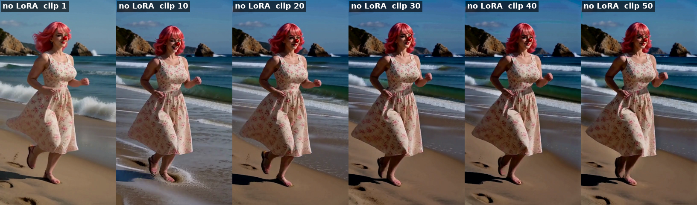

# Test 14: Anti-Burn LoRA strength on a moving scene (50 clips)

Test 13 ([static chair](../20261104/static_chair_lora_test.md)) showed no visible difference between no LoRA, 0.2, 0.4 and 0.6 on a still scene. This repeats the same four strengths on a moving scene, the beach run from [test 11](../20261104/antiburn_results.md), where the LoRA did help, but for 50 clips of the same scene so the drift has longer to build.

## Setup

- **Scene:** she runs along the same sunny beach for all 50 clips (no scene changes), tracking camera. Clip 1 is the same start as the [50-clip test](../20261101/frame0_conclusions.md#10-beach-benchmark-a-50-clip-chain-through-four-scenes); clips 2–50 each continue the run with one small action (glancing at the waves, brushing her hair back, splashing through foam, and so on). Prompts: [prompts/beach_lora50](prompts/beach_lora50).
- **Chain:** 50 clips of 8 s, 480 × 864, Geiru Context 39 / drop last 17, seed 1234, 8 steps er_sde / beta.
- **Degradation protection on for the whole run:** keystone + capstone from clip 1, context noise linear 1, **Late Lock capstone at swap_step 6** (the capstone only comes in for steps 7 and 8; tests 10–13 used 4).
- **Four runs:**
  1. No LoRA
  2. Anti-Burn 0.2
  3. Anti-Burn 0.4
  4. Anti-Burn 0.6
- The LoRA is only on clips 2–50, never clip 1, so all four runs start from the same clip 1.

## What we're looking for

- Burn: crunchy, over-sharpened texture building up (skin, sand, waves).
- Smoothing: does fine texture go soft as the strength goes up?
- Colour drift from clip 1.
- Motion: does a higher strength change how she moves?

*(done: all four runs finished 2026-11-05)*

Stitched into one 5 min 20 s video per run, plus a 4-up side-by-side (no LoRA | 0.2 | 0.4 | 0.6) and a sped-up GIF of the 4-up, on roycho's PC in `output\minimax\beach_lora50\stitched\`.

**Verdict (roycho, by eye):** no visible difference. In roycho's own side-by-side (stitched in his editor, straight from the original clips), no LoRA, 0.2, 0.4 and 0.6 look the same in colour.

- **The colour gain from test 11 couldn't be replicated.** The suspected cause is double compression of one of the initial side-by-side videos during stitching. The 4-up made for this test isn't reliable for colour either.
- **The LoRA was checked and loaded correctly:** on at the right strength from clip 2, wired into the sampler, and every layer matches the H3 model.
- **It doesn't hurt fine detail** (test 13 showed no softening at any strength).
- **Why it was thought to cause smoothing (roycho's theory):** the smoothing some people saw with this LoRA is suspected to be the detail loss that comes with normal degradation. Because the LoRA preserves colour, that loss showed up as smoothing instead of the usual crushed blacks and waxy skin we're all familiar with.
- **The LoRA itself works:** roycho tested it previously on its own, without these nodes, and it had a positive impact on colour. What these tests couldn't show is any extra colour gain on top of degradation protection.
- **Geiru Protection LoRA moved to an experimental repo,** [Geiru-Protection-LoRa-Experimental](https://github.com/roycho87/Geiru-Protection-LoRa-Experimental). roycho plans to explore using a LoRA with this loader, on top of the protection nodes, to preserve colour better. Please try it and share what you find; more testing is needed.

## Baseline result: no LoRA, 50 clips (done)

*Frames 4 s into clips 1, 10, 20, 30, 40 and 50 of the no-LoRA run.*

By eye (roycho):

- **There is some darkening over the 50 clips, but it never goes below a certain level.** It settles a little darker than the keystone (clip 1) and holds there instead of getting darker and darker.
- **The quality holds without the LoRA.** Her face, hair, dress pattern, the sand and the waves stay clean through clip 50, with no build-up of burn or grit.

- **By clip 10 it has darkened all it's going to.** From there to clip 50 it holds at that level.

This matches the earlier tests: degradation protection stops the drift from stacking up, but leaves a small, steady darkening.

**Idea (roycho): with the LoRA, the keystone could come from the previous clip instead of clip 1 every time.** Right now the keystone has to come from a fixed clip (clip 1, or the first clip of a new scene): without that, it darkens beyond control, so we have to pick a clip to keep it from going too dark. If the Anti-Burn LoRA holds the colour on its own, a rolling keystone from the clip before could work instead, and the shot wouldn't be pulled back toward clip 1. More tests. Next: compare with the 0.2, 0.4 and 0.6 runs to see whether the LoRA closes that gap, and what it does to quality.
