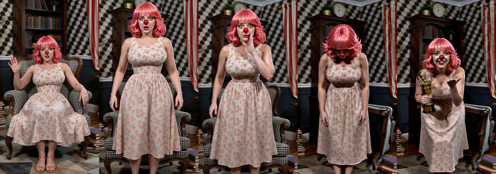
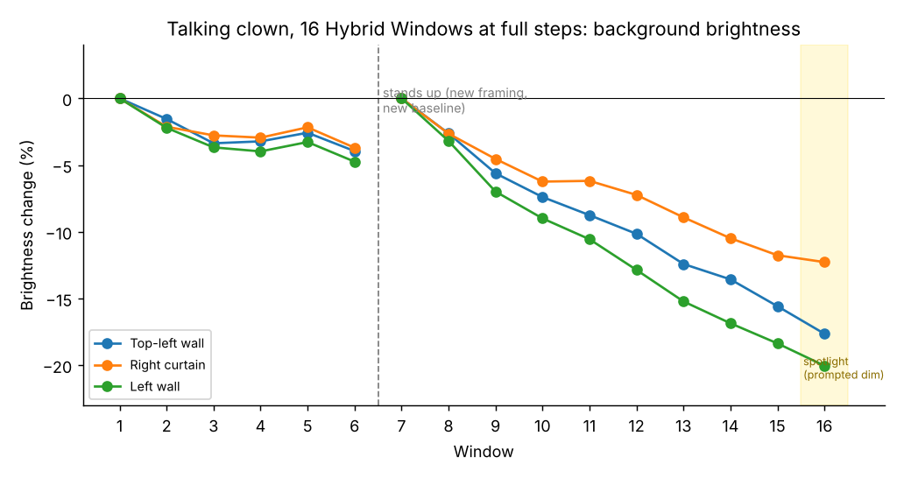

# Test 15: a talking clown in 16 Hybrid Windows at full steps

A 2 min 6 s talking video in one Geiru Hybrid Windows render: the clown talks to the camera, gets fed up, flips her armchair and wins an award. Every window runs all its steps on its own, so the anti-degradation features are the only thing keeping it from drifting.

## Video

*(space for the video)*

## Setup

- 3031 frames (2:06) at 544 × 960 (portrait), 16 windows of 226 frames, overlap 39.
- One prompt per window, Ref2AV, with roycho's own recorded voice as the audio (split per window, each prompt worded exactly like its part of the recording).
- **`switch_step` 8:** every window renders all 8 steps on its own, with no blended pass and `finished_handoff` off.
- Keystone and capstone on (`capstone_step` 6), context noise linear 1, `fuse_method` pyramid, `freenoise` off, crash protection on.
- Turbo 8-step LoRA and Motion Booster LoRA at 1, er_sde / beta, 8 steps.

## Result

**By eye (roycho): no visible degradation.**

*Windows 1 (seated), 6 (just stood up), 7, 15 and 16 (the award).*

Measured on fixed patches of wall and curtain she never covers, the background darkens slowly. She stands up at the end of window 6 and the framing changes, so windows 1–6 and 7–16 are measured from their own starts:

| Window | Top-left wall | Right curtain | Left wall |
|---|---|---|---|
| 1 | baseline | baseline | baseline |
| 6 | −4.0% | −3.7% | −4.7% |
| 7 | new baseline (standing) | | |
| 10 | −7.4% | −6.2% | −9.0% |
| 13 | −12.4% | −8.9% | −15.2% |
| 15 | −15.6% | −11.8% | −18.4% |
| 16 | −17.6% | −12.3% | −20.0% |

- Seated (windows 1–6): almost flat, about 4% darker by window 6.
- Standing (windows 7–16): a slow, steady drift of about 1.5–2% per window, 12–18% darker by window 15. No burn, crushed blacks or waxy skin. Window 16 is the spotlight scene, where the prompt dims the room.
- Saturation goes up about 15% over the run.
- Per-window numbers: [talk16_background_brightness.csv](media/talk16_background_brightness.csv).

## What this means

**Hybrid Windows is not as good as the continuation nodes at preventing degradation, but that is not its purpose.** It's meant for scenes with fast motion that need to be seamless.

It's recommended to use it as a hybrid window, with at least two blend steps using `finished_handoff` (for example `switch_step` 6 of 8 with `finished_handoff` on), to get more consistency than standard hybrid windows allow.

**This was a test of extremes,** not something meant to imply the purpose of the node.

## Prompting notes

All found by watching the renders. Each was a cut in the middle of a window:

- **Anything that changes the framing reads as a cut.** Walking up to the camera, leaning in to whisper, a "tight close-up" for one line, the camera rising as she stands: each made the model cut. What worked: one camera line saying the camera never moves, zooms or pushes in, and that she never steps or leans toward it.
- **Actions that need a different framing cut too.** Kicking books needed her feet in a chest-up shot, so it cut to a wider shot. Flipping the armchair behind her works in the same framing.
- **The keystone pulls toward window 1.** Window 1 is seated, so standing windows that said little about her pose snapped back to sitting. Saying she stands in front of the empty armchair and never sits down fixed it.
- **Room text that changes all at once reads as a cut.** Only describe what she actually changed (the flipped chair).
- **Put the camera line first** and keep the room description short, or the model opens on a wide shot of the room.
