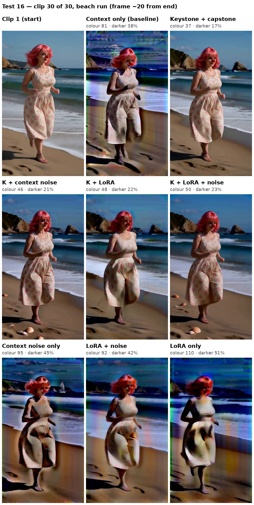

# Test 16: every combination of the three protections (30 beach clips)

Which of the three degradation protections does the work, and do they add up? Eight 30-clip chains of the same beach run, one for every combination of:

- **K: keystone + capstone** (always together, as one unit): Geiru Keystone (`keystone front + capstone back`, from clip 1) with Late Lock on the capstone at `swap_step` 6.
- **L: the protection LoRA**: the experimental [Geiru Protection LoRA](https://github.com/roycho87/Geiru-Protection-LoRa-Experimental) node with Imagineer13's H3 Anti-Burn LoRA at 0.6.
- **N: context noise**: Geiru Context Noise, linear, strength 1.

## Runs

| Run | Keystone + capstone | Protection LoRA | Context noise |
|---|---|---|---|
| 1. Context only | | | |
| 2. K | ✓ | | |
| 3. L | | ✓ | |
| 4. N | | | ✓ |
| 5. K + L | ✓ | ✓ | |
| 6. K + N | ✓ | | ✓ |
| 7. L + N | | ✓ | ✓ |
| 8. K + L + N | ✓ | ✓ | ✓ |

## Setup (the same for every run)

- **Scene:** the beach run from [test 14](../20261105/beach_lora_strength_test.md), clips 1–30 of the same prompts ([prompts/beach_lora50](../20261105/prompts/beach_lora50)), one continuous scene.
- **Chain:** 30 clips of 8 s, 480 × 864, seed 1234, 8 steps er_sde / beta, the 8-step turbo LoRA.
- **Geiru Context:** 39 frames, drop last 17, audio drop last 17, `degradation_protection` on (each protection is turned on or off on its own node).
- None of the protections touch clip 1, so all eight runs start from the same clip 1.

## What we're looking for

- How much each run drifts from clip 1 to clip 30 (darkening, colour, burn, detail).
- Which protection on its own cuts the drift the most, compared with context only.
- Whether the pairs and all three together do better than the best one alone.

## Results

All 30 clips of every run are the beach run (no scene change), so everything is measured against clip 1.

Clip 20: [every run](media/beach30_combos_clip20.jpg). Raw numbers for every clip: [beach30_combos_metrics.csv](media/beach30_combos_metrics.csv).

**Baseline (context only), clip 1 → clip 30:** corner colour drift 81, 38% darker, and grit went from 0.75 to 2.80 (almost 4× clip 1).

Each setup at clip 30 (average of clips 26–30), and how much it cuts the baseline's drift:

| Setup | Colour drift | Darkening | Extra grit cut |
|---|---|---|---|
| Context only (baseline) | 81 | 38% | – |
| K | 37 (cuts 54%) | 17% (cuts 56%) | 81% |
| K + N | 46 (cuts 43%) | 21% (cuts 44%) | 80% |
| K + L | 48 (cuts 40%) | 22% (cuts 42%) | 88% |
| K + L + N | 50 (cuts 38%) | 23% (cuts 40%) | 93% |
| N | 95 (17% worse) | 45% (19% worse) | 61% |
| L + N | 92 (14% worse) | 42% (13% worse) | 80% |
| L | 110 (37% worse) | 51% (36% worse) | 70% |

**What it means:**

- **Keystone + capstone does almost all the work.** Every run with K roughly halves the colour drift and the darkening. Every run without it ends up as dark and discoloured as context only, or worse.
- **K alone was best on colour and brightness.** Adding the LoRA, context noise or both made colour slightly worse but left a little less grit. The least grit was K + L + N.
- **Without K, the LoRA and context noise don't stop the drift.** They cut some fine grain, but by eye L and L + N have the worst stripes and banding in the sky by clip 30 (the grit number only measures fine grain, not big streaks).
- **At clip 20 the four K runs are about tied** (colour 34–47). They only spread out by clip 30.

**Caveats:** one seed, and the camera moves, so the corners don't show exactly the same content in every clip. Differences of a few points between the K runs are about noise level; the gap between the K runs and the rest is real. A second test (forest trail, seed 5678, context only and the four K runs) is running to check it.

**How it's measured:** the four corners of the frame (top: sky; bottom: sand), averaged over frames 166–178 of each clip (about 20 frames from the end). Colour drift is the RGB distance from clip 1's corners; darkening is the drop in corner brightness against clip 1 (121.5); grit is the fine grain in the corners (the difference from a slightly blurred copy). Clip 30 numbers are the average of clips 26–30.
