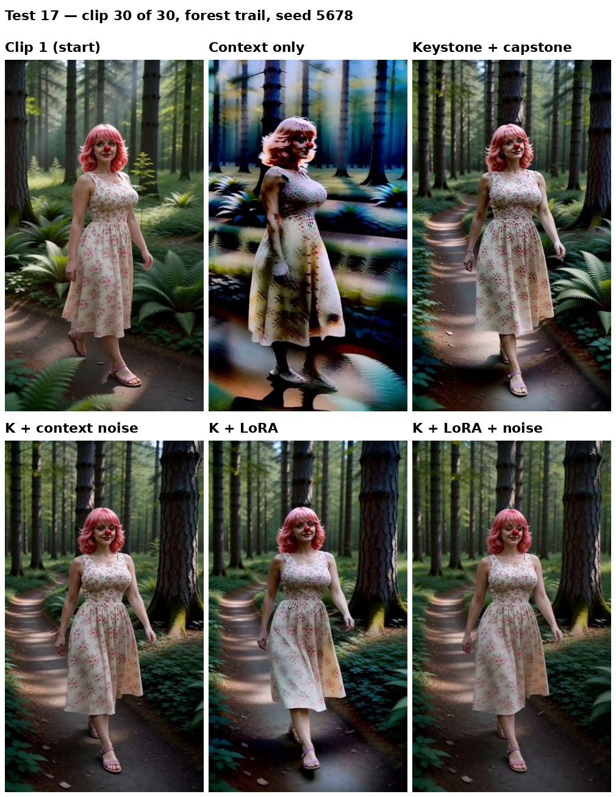

# Test 17: the protections again, on a forest trail with a new seed

A check on [test 16](beach30_protection_combos.md) with a different scene and seed. Test 16 found that keystone + capstone did almost all the work. This test repeats context only and the four keystone runs to see if that holds.

- **K: keystone + capstone** (always together): Geiru Keystone (`keystone front + capstone back`, from clip 1) with Late Lock on the capstone at `swap_step` 6.
- **L: the protection LoRA**: the experimental [Geiru Protection LoRA](https://github.com/roycho87/Geiru-Protection-LoRa-Experimental) node with Imagineer13's H3 Anti-Burn LoRA at 0.6.
- **N: context noise**: Geiru Context Noise, linear, strength 1.

## Runs

| Run | Keystone + capstone | Protection LoRA | Context noise |
|---|---|---|---|
| 1. Context only | | | |
| 2. K | ✓ | | |
| 3. K + N | ✓ | | ✓ |
| 4. K + L | ✓ | ✓ | |
| 5. K + L + N | ✓ | ✓ | ✓ |

## Setup (the same for every run)

- **Scene:** she walks along a sunny forest trail, with the camera tracking beside her, one continuous scene ([prompts/forest30](prompts/forest30)).
- **Chain:** 30 clips of 8 s, 480 × 864, **seed 5678**, 8 steps er_sde / beta, the 8-step turbo LoRA.
- **Geiru Context:** 39 frames, drop last 17, audio drop last 17, `degradation_protection` on.
- Everything else is the same as test 16. All five runs start from the same clip 1.

## Results

Clip 20: [every run](media/forest30_combos_clip20.jpg). Raw numbers for every clip: [forest30_combos_metrics.csv](media/forest30_combos_metrics.csv).

**By eye (roycho):** context only fell apart. All four keystone runs look clean at clip 30. There's no visible benefit from context noise or the LoRA, and only a slight one from the LoRA over keystone alone.

**Baseline (context only), clip 1 → clip 30:** the picture is smeared and streaky, the colours are oversaturated and turn blue, and the edges are over-sharpened. Saturation is up 44% from clip 1.

Each setup at clip 30 (average of clips 26–30), and how much it cuts the baseline's drift:

| Setup | Saturation drift | Corner colour drift | Over-sharpening |
|---|---|---|---|
| Context only (baseline) | +44% | 56 | +41% |
| K | +7% (cuts 85%) | 36 (cuts 35%) | +28% |
| K + N | +5% (cuts 88%) | 39 (cuts 31%) | none (−14%) |
| K + L + N | +6% (cuts 86%) | 36 (cuts 35%) | none (−36%) |
| K + L | +14% (cuts 67%) | 46 (cuts 18%) | none (−2%) |

**What it means:**

- **Same result as test 16.** Keystone + capstone stops the drift. Without it the chain falls apart.
- **Context noise and the LoRA add little or nothing you can see on top of the keystone.** The four keystone runs are within a few points of each other, far from context only.
- The numbers show small differences, like keystone alone over-sharpening a bit (+28%) where the runs with noise or the LoRA don't. That fits the earlier [noise strength sweep](../20261101/frame0_conclusions.md), where context noise mostly changed the grain, not the colour. These differences are hard to see by eye.

**Caveats:**
- One seed per scene.
- The camera moves past different trees, so the corners don't show the same content from clip to clip. Corner brightness wasn't usable here: the keystone runs read darker only because big trunks end up in the corners. Saturation and sharpness hold up better against changing content.
- K + L + N's −36% sharpness may mean it's a little soft, not just free of over-sharpening.

**How it's measured:** frames 166–178 of each clip (about 20 frames from the end). Saturation is the whole frame's average colour saturation; over-sharpening is the whole frame's edge strength (Laplacian variance); both are compared with clip 1. Corner colour drift is the same RGB corner measure as test 16. Clip 30 numbers are the average of clips 26–30.
