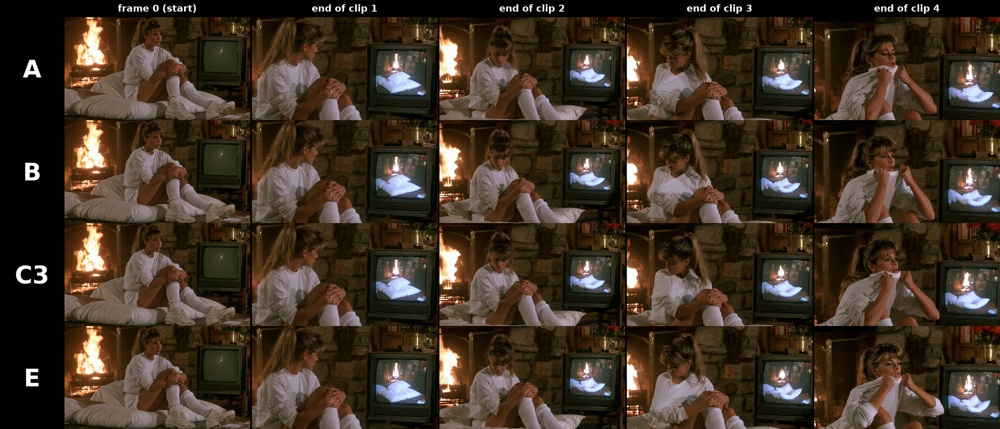

> **Contributor: TrentHunter82 (Flipping Sigmas)** ([TrentNodes](https://github.com/TrentHunter82/TrentNodes)). Posted as [NerdNotes issue #3](https://github.com/roycho87/NerdNotes/issues/3) on 2026-11-08 and kept as he wrote it. **Not** covered by NerdNotes' CC BY-SA 4.0 license: it stays under his own terms.

## Split unsample for H3 continuations: test data (TrentHunter82 / Flipping Sigmas)

The old AnimateDiff unsample/resample trick, applied to the copied overlap only. In a 4-clip fixed-prompt test it roughly halved the saturation drift and kept the edge detail. Context noise (and context noise fed with unsampled noise) gave no measurable gain in the same test. It is one seed and one scene, so treat it as a lead, not a result.

### The method (E)

Pika Flex 6-step schedule `1.0, 0.972973, 0.923077, 0.8, 0.571429, 0.333333, 0.0`, split 3 + 3 at sigma 0.8.

1. **Unsample the finished clip.** Run the finished clip backwards 3 steps (0 -> 0.8) with `FlipSigmas` + `SplitSigmas`, euler, `DisableNoise`, the same guider. Save the result for the next clip.
2. **Next clip, first half.** Sample 3 steps (1.0 -> 0.8) with the copied overlap locked (mask 0), as in a normal continuation.
3. **Swap.** Put the unsampled copies of the overlap latents (1 to held-2) into the half-sampled latent and open their mask (1). Latent 0 and the last held latent stay locked.
4. **Second half.** Sample the last 3 steps (0.8 -> 0) with `DisableNoise`. The new frames and the half-noised overlap finish together.

So the overlap is not traced from the clean previous clip. It is re-developed from a half-noised copy of it, in the same steps as the new frames. Same step count as a plain 6-step run, plus 3 unsample steps.

One detail: the partial sampler returns locked rows scaled by 1/(1-sigma) (CONST `inverse_noise_scaling`). The swap node restores mask-0 positions to their clean values before step 4.

### Setup

* MiniMax H3 `minimax_h3_fused_refdelta_r1024_turbo8_mystic07_int8_convrot` + Pika H3 Flex fl2va LoRA (strength 1), er_sde, i2va prompts (not ref2va).
* 864x480, 141 frames per clip, 39-frame overlap (12 video latents), seed 20261107, 4 clips.
* **No keystone / capstone in any run.** Our `keep_look_of_clip_1` was off; the pinned first frame of each clip was frame 102 of the clip before. So E was measured against a plain chain, not against your keystone + capstone.
* **Fixed prompts.** All four runs got the same 4 prompts (taken from A's Codex run). The fixed A was pixel-identical to the original A run, so only the continuation method differs.

| Run | Method |
|---|---|
| A | Plain continuation (overlap locked) |
| B | Context noise (Geiru / ethanfel style ramp, 1.0 -> 0 at the join) |
| C3 | Context noise 0.8, noise from a 3-step unsample in place of random noise |
| E | Split unsample (above) |

### Results

Last frame of each clip (frames 140, 242, 344, 446). Metrics on the full RGB frame: brightness = mean, contrast = std, saturation = mean HSV S (0-255), edge detail = variance of PIL `FIND_EDGES`, diff = mean abs difference from A at the same frame.

| Frame | A sat / edge / bright | B sat / edge / bright | C3 sat / edge / bright | E sat / edge / bright |
|---|---|---|---|---|
| 0 (start image) | 146.0 / 333 / 65.8 | 146.0 / 333 / 65.8 | 146.0 / 333 / 65.8 | 145.9 / 335 / 65.8 |
| 140 (clip 1) | 147.2 / 204 / 54.6 | 147.3 / 204 / 54.6 | 147.2 / 204 / 54.6 | 147.6 / 199 / 54.4 |
| 242 (clip 2) | 149.9 / 272 / 59.5 | 151.0 / 293 / 59.5 | 150.9 / 288 / 59.4 | 149.0 / 269 / 60.0 |
| 344 (clip 3) | 153.4 / 217 / 54.5 | 152.6 / 234 / 54.8 | 154.9 / 219 / 53.6 | 148.4 / 252 / 58.7 |
| 446 (clip 4) | **161.9 / 145 / 48.9** | 161.8 / 152 / 48.9 | 161.2 / 154 / 48.9 | **155.3 / 196 / 53.0** |

Clip 1 -> clip 4:

* **Saturation:** A +14.7, B +14.5, C3 +14.0, **E +7.7**
* **Edge detail:** A 204 -> 145, B 204 -> 152, C3 204 -> 154, **E 199 -> 196**
* **Brightness (darkening):** A 54.6 -> 48.9, B and C3 the same, **E 54.4 -> 53.0**
* **Contrast:** A 48.3 -> 45.6, **E 48.4 -> 49.7**
* Diff from A at clip 4: B 12.4, C3 16.1, E 18.6 (E is the furthest from the drifting baseline)

### Other findings

* **Unsampled noise from a turbo model is weak.** A 3-step euler unsample gave std 0.52 (C), 0.51 (C3) and 0.43 for a 1-step unsample. Correlation with the frames was only about 0.08, so it is close to white noise. A full unsample cannot reach sigma 1.0 exactly, because the partial sampler returns x/(1-s). That is why C/C3 (context noise fed with unsampled noise) did no better than B.
* **Context noise alone (B)** showed no measurable gain over A in this short test. Your 50-clip and 30-clip tests are much longer, so this does not contradict them.

### Limits

* One seed, one scene (grindhouse woman by a fireplace), 4 clips, 864x480.
* The edge metric moves with the content, so frame-to-frame values jump; the clip 1 -> 4 trend is the useful part.
* Not yet tested together with keystone + capstone, or with the Anti-Burn LoRA.

**Suggested test for your next round:** E on top of keystone + capstone, on your 30-clip beach benchmark. Keystone + capstone fixes what frame 0 carries forward; the split unsample re-develops the overlap, so the two may stack.

### Code

[TrentNodes](https://github.com/TrentHunter82/TrentNodes) commit [9096f4b](https://github.com/TrentHunter82/TrentNodes/commit/9096f4b), `nodes/h3_video_chain.py`:

* `H3SwapUnsampledContext` (inputs `latent`, `sampled`, `unsampled`): step 3 above.
* `H3ContextNoise`: the context noise used in B and C3.

The rest of the graph is core nodes: `SplitSigmas`, `FlipSigmas`, `DisableNoise`, `SamplerCustomAdvanced`, and Save for Next Time / Take from Last Time to carry the unsampled latent between clips.
