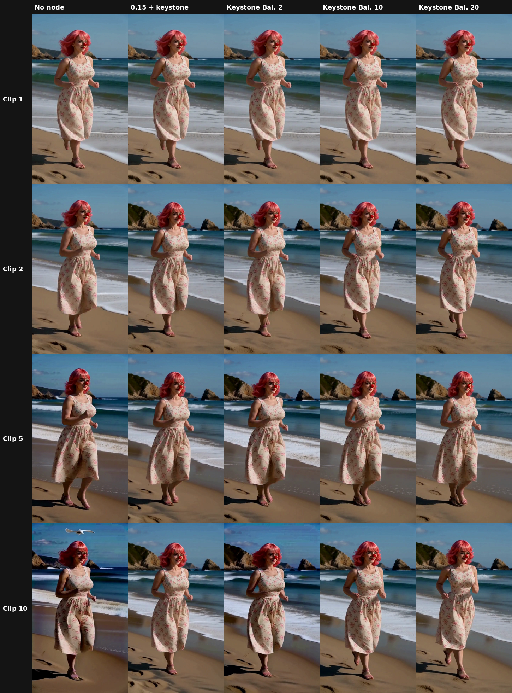

# Test 19: attention on the carried frames and the keystone

ckinpdx found that turning down H3's attention on the carried frames, and up on the reference pictures, held a 173-second talking head together ([his notes](community/ckinpdx_carry_attention.md)). This test asks whether the carry half of that, on its own, slows the darkening on the beach benchmark, and what happens when the keystone is added.

## Short version

1. **Turning the carry down doesn't slow the darkening on its own.** At context 0.40 and 0.15, clip 10 ended up about as dark as with no node at all (−29.7% and −26.5%, against −28.0%).
2. **It behaves like a switch, not a dial.** The darkening is in the carried frames themselves. As long as the new frames continue from them, they inherit it. The only way out is for the model to stop continuing and redraw, and that's when the joins break (ckinpdx saw that at −3).
3. **Carry turned down + keystone is the best result so far:** −9.5% at clip 10, against −19.7% for keystone + capstone (test 16's K run) and −28.0% for nothing, with no capstone at all.
4. **Leaning on the keystone works better than starving the carry.** A new node, Geiru Keystone Balance, moves attention from the carry to the keystone *inside their shared slice only*, leaving the prompt, references and audio untouched. At balance 20, clip 10 ended **−6.9%**, the best result so far, and it got brighter from clip 5 to clip 10. Watched as video, it doesn't darken.
5. **The keystone also pulls the scenery back.** In every keystone run, clip 2's background drifts back to clip 1's opening view (the big cliff and sea stacks) over about 2 seconds, then stays. It isn't a cut; it's the keystone holding the whole shot to clip 1's first frame.
6. **Next: find which blocks carry brightness,** so the balance only acts there and nothing else changes.

*Frame 172 of clips 1, 2, 5 and 10. Left to right: no node, context 0.40, context 0.15, context 0.15 + keystone.*

## Setup

* The 30-clip beach benchmark graph (seed 1234, the beach_lora50 prompts), first 10 clips only.
* Geiru Context with `audio_hold_mode` normal, 39 held frames. No Late Lock, no capstone, no context noise.
* The Sage patch node off (the attention node replaces H3's attention, see the notes at the end).
* **Geiru Attention Balance** (private experimental pack) on the model: `context_strength` multiplies the carried frames' share of attention before it's re-split. 0.40 is a bias of about −0.9 in ckinpdx's terms, 0.15 about −1.9. Reference strength left at 1 (off).
* Darkening is measured on four corner patches, frames 166–178, compared with clip 1. The limit for "holds" is 5%.

## Results

Brightness at frames 166–178, compared with clip 1:

| Clip | No node | Keystone + capstone (K) | Context 0.40 | Context 0.15 | 0.15 + keystone |
|---|---|---|---|---|---|
| 2 | −6.8% | −4.9% | −4.5% | −5.1% | −7.0% |
| 5 | −17.9% | −12.3% | −12.4% | −19.5% | −12.3% |
| 10 | −28.0% | −19.7% | −29.7% | −26.5% | **−9.5%** |

* "Keystone + capstone (K)" is the K run from [test 16](../20261107/beach30_protection_combos.md) on the same benchmark: keystone front + capstone back, Late Lock at swap step 6, Sage patch on. Keystone alone (no capstone) hasn't been run on this benchmark.
* Colour drift at clip 10 (average colour change of the corners): 60.3 with no node, 20.5 with 0.15 + keystone.
* No run showed a motion jump at the clip 1 → 2 join in the frame-to-frame numbers. Whether the motion looks right is judged by eye.
* An earlier 0.70 run matched the plain chain almost exactly (−17.6% vs −17.7% at clip 4) and was stopped.

## Why the carry dial does so little

Each token's attention is one pie that always adds up to 100%: the prompt, the reference pictures, the audio, the new frames, the carried frames and the keystone each get a slice. Turning one slice down gives its share to everything else.

Turning the carry down doesn't change *what* is carried. The held frames are copied in and locked, already a little darker than the clip before. The new frames still continue from them, so the darkening comes through. Push it far enough and the model stops continuing and draws its own version instead, which is a cut at the join.

With the keystone in, the share the carry gives up goes partly to the one clean frame the new frames still look at fully. That's why 0.15 + keystone did so much better than either one alone.

ckinpdx's reference boost (+2, about 7.4× the reference's share) works the same way, by pulling toward something clean. But it takes its extra share from everything, the prompt and audio included. On a static talking head that costs nothing visible. On a moving scene it could pull the pose or framing back toward the reference picture.

## Geiru Keystone Balance (experimental, in testing)

A new node in the private experimental pack. It measures, for every token, head and block, the slice the keystone and the carried frames share together. It leaves every other slice exactly as H3 would make it, and only re-splits that one slice:

* `balance` 1 = normal. At 2, the keystone pulls twice as hard compared with the carry, and the carry gives up exactly what the keystone gains.
* It reads Geiru Keystone's output latent to find the keystone, and follows Geiru Context's `degradation_protection` switch.
* Checked against a by-hand calculation: the same result to 7 decimal places, with every other slice unchanged.

### Results

Keystone on (front only, no capstone), no carry turn-down, same benchmark, 10 clips. Brightness at frames 166–178 compared with clip 1:

| Clip | No node | K (keystone + capstone) | 0.15 + keystone | Balance 2 | Balance 10 | Balance 20 |
|---|---|---|---|---|---|---|
| 2 | −6.8% | −4.9% | −7.0% | −5.7% | −6.2% | −6.5% |
| 5 | −17.9% | −12.3% | −12.3% | −12.9% | −10.2% | −9.0% |
| 10 | −28.0% | −19.7% | −9.5% | −19.4% | −11.1% | **−6.9%** |

*Frame 172 of clips 1, 2, 5 and 10. Left to right: no node, 0.15 + keystone, Keystone Balance 2, 10 and 20.*

* Balance 2 matched keystone + capstone without a capstone. Balance 10 almost stopped the darkening after clip 5 (−10.2% → −11.1%). Balance 20 reversed it (−9.0% → −6.9%).
* Colour drift at clip 10: 60.3 with no node, 23.8 at balance 10.
* No motion jump at the clip 1 → 2 join in the frame-to-frame numbers, and she isn't pulled back to clip 1's pose. Judged by eye on the stitched videos, balance 20 doesn't darken.

**How small the slice is.** The node logs the average shares for block 0. There, the keystone and the carried frames together get only about 5% of each token's attention:

| Block 0 | Normal | Balance 2 | Balance 10 |
|---|---|---|---|
| Keystone | 0.78% | 1.10% | 2.14% |
| Carried frames | 4.55% | 4.23% | 3.22% |
| Everything else | 94.67% | unchanged | unchanged |

So balance 2 moves about a third of a percent of the attention in that block, and even balance 10 leaves the carried frames about 70% of their normal share. The 0.78% is an average: for most tokens the keystone's share is tiny, and multiplying a tiny share still moves little. The node works in all 50 blocks but only logs block 0, and each block splits its attention differently, so the keystone's slice may be bigger in later ones.

## The scenery pull-back

In the keystone runs, clip 2's carried frames (about frames 20–50) continue clip 1's ending background, the small low rocks. Over frames 50–100 the big cliff and sea stacks from clip 1's first frame come back, and they stay for the rest of the chain. Without a keystone the small rocks carry on. It happens at balance 2 as well, so it comes from the keystone, not from the balance. In a shot where the camera is meant to travel to new scenery, that would fight it.

One test-graph detail: these runs didn't put the real latent 0 back after sampling, so frame 0 of each clip is the keystone itself, and frames 1–4 are affected by it. The stitched comparison videos cut 5 frames into each new clip.

## Which blocks do what: what's known

Nobody has published which H3 blocks carry brightness or colour. What there is:

* **Blocks 0–19 are the motion-heavy ones** (Ada, from LoRA training). Likeness LoRAs skip 0–19 to keep motion and sharpness (Father Gizmo, Fizgig's likeness mode; JohnDopamine trains blocks 20+ for image-only runs).
* **Style LoRAs land best on blocks 0–3 and 6–47,** avoiding 4–5 (Ada).
* **Timing sits late:** matlowai's DyRoPE presets use blocks 30–49 for timing and 40–49 for shimmer.
* **"Style lives in AdaLN"** (mrassets): each block has a large set of noise-level-driven scale, shift and gate dials. Much of the overall look may be set there rather than by attention, which would limit what an attention fix can do.
* **matlowai's H3 Delta Color Carry** cancels darkening from a VAE round trip on carried frames. The Geiru chains keep the carried frames as latents, so that's probably a different cause.
* **On other diffusion transformers,** early blocks set layout and meaning and late blocks draw fine detail, and colour follows the same early-to-middle pattern as shape ([Unraveling MMDiT Blocks](https://arxiv.org/html/2601.02211)). The standard way to find a block's job is to change one block at a time and measure the result ([Stable Flow](https://arxiv.org/html/2411.14430v1)).

## Next test: which blocks carry brightness (built, not run yet)

A black frame goes in as the keystone. Every run makes only clip 2, from the same clip 1, so each one takes about 7 minutes. The brightness of clip 2's new frames (40–191) is compared with a normal-keystone clip 2:

* **ref_normal:** normal keystone, no balance.
* **blk_none:** black keystone, no balance (how much darkness gets through by default).
* **blk_all:** black keystone, balance 20 on all blocks (the most it can pull).
* **Five runs** with balance 20 on one group of 10 blocks only: 0–9, 10–19, 20–29, 30–39, 40–49.

The groups that pull clip 2 darkest are where the keystone's brightness gets copied. The strongest group is then split into pairs, and the strongest pair into single blocks, about 15 clips in all. The winning blocks then get checked on the normal 10-clip test, since a black keystone is an extreme case.

## Notes

* **Sage:** both Geiru Attention Balance and ckinpdx's node fall back to plain PyTorch attention on the calls they change, because Sage on a 50-series card doesn't take an attention bias. Kijai's Sage patch node replaces the attention hook, so an attention node has to come **after** it on the model line, or it gets wiped out.
* **Limits:** one scene, one seed, 10 clips, measured on corner patches. Balance 20 is the node's current maximum. The darkening numbers are reliable for comparing runs; motion and look are judged by eye.

**Credits:** ckinpdx for Carry Attention and the idea of biasing H3's attention by part of the sequence.
