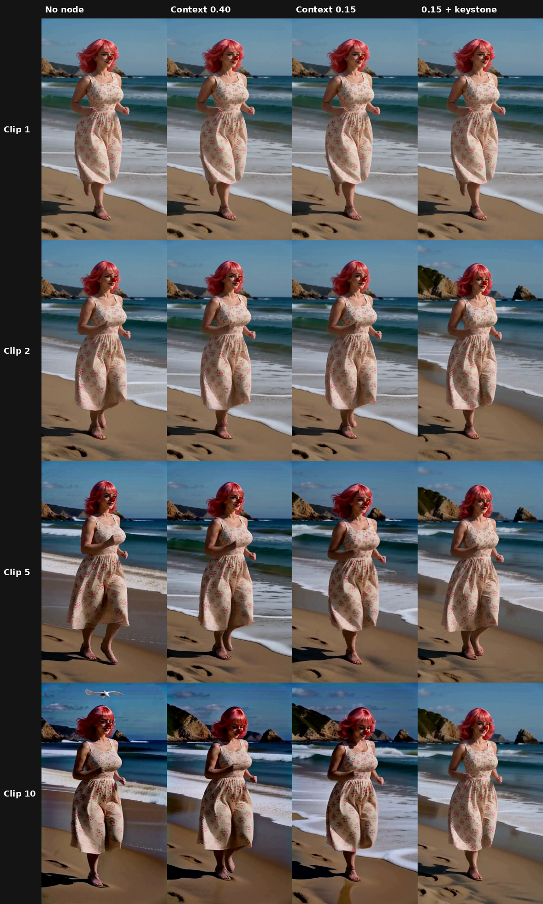

# Test 19: turning down attention on the carried frames

ckinpdx found that turning down H3's attention on the carried frames, and up on the reference pictures, held a 173-second talking head together ([his notes](community/ckinpdx_carry_attention.md)). This test asks whether the carry half of that, on its own, slows the darkening on the beach benchmark, and what happens when the keystone is added.

## Short version

1. **Turning the carry down doesn't slow the darkening on its own.** At context 0.40 and 0.15, clip 10 ended up about as dark as with no node at all (−29.7% and −26.5%, against −28.0%).
2. **It behaves like a switch, not a dial.** The darkening is in the carried frames themselves. As long as the new frames continue from them, they inherit it. The only way out is for the model to stop continuing and redraw, and that's when the joins break (ckinpdx saw that at −3).
3. **Carry turned down + keystone is the best result so far:** −9.5% at clip 10, against −19.7% for keystone alone and −28.0% for nothing. The scene redrew once at the first join (new rocks and coastline), then held steady from clip 2 to clip 10.
4. **Next: lean on the keystone instead of starving the carry.** A new node, Geiru Keystone Balance, moves attention from the carry to the keystone *inside their shared slice only*, leaving the prompt, references and audio untouched. Its first run is going now.

*Frame 172 of clips 1, 2, 5 and 10. Left to right: no node, context 0.40, context 0.15, context 0.15 + keystone.*

## Setup

* The 30-clip beach benchmark graph (seed 1234, the beach_lora50 prompts), first 10 clips only.
* Geiru Context with `audio_hold_mode` normal, 39 held frames. No Late Lock, no capstone, no context noise.
* The Sage patch node off (the attention node replaces H3's attention, see the notes at the end).
* **Geiru Attention Balance** (private experimental pack) on the model: `context_strength` multiplies the carried frames' share of attention before it's re-split. 0.40 is a bias of about −0.9 in ckinpdx's terms, 0.15 about −1.9. Reference strength left at 1 (off).
* Darkening is measured on four corner patches, frames 166–178, compared with clip 1. The limit for "holds" is 5%.

## Results

Brightness at frames 166–178, compared with clip 1:

| Clip | No node | Keystone alone | Context 0.40 | Context 0.15 | 0.15 + keystone |
|---|---|---|---|---|---|
| 2 | −6.8% | – | −4.5% | −5.1% | −7.0% |
| 5 | −17.9% | – | −12.4% | −19.5% | −12.3% |
| 10 | −28.0% | −19.7% | −29.7% | −26.5% | **−9.5%** |

* "Keystone alone" is the earlier keystone run on the same benchmark, with the Sage patch on.
* Colour drift at clip 10 (average colour change of the corners): 60.3 with no node, 20.5 with 0.15 + keystone.
* No run showed a motion jump at the clip 1 → 2 join in the frame-to-frame numbers. Whether the motion looks right is judged by eye.
* An earlier 0.70 run matched the plain chain almost exactly (−17.6% vs −17.7% at clip 4) and was stopped.

## Why the carry dial does so little

Each token's attention is one pie that always adds up to 100%: the prompt, the reference pictures, the audio, the new frames, the carried frames and the keystone each get a slice. Turning one slice down gives its share to everything else.

Turning the carry down doesn't change *what* is carried. The held frames are copied in and locked, already a little darker than the clip before. The new frames still continue from them, so the darkening comes through. Push it far enough and the model stops continuing and draws its own version instead, which is a cut at the join.

With the keystone in, the share the carry gives up goes partly to the one clean frame the new frames still look at fully. That's why 0.15 + keystone did so much better than either one alone.

ckinpdx's reference boost (+2, about 7.4× the reference's share) works the same way, by pulling toward something clean. But it takes its extra share from everything, the prompt and audio included. On a static talking head that costs nothing visible. On a moving scene it could pull the pose or framing back toward the reference picture.

## Geiru Keystone Balance (experimental, in testing)

A new node in the private experimental pack. It measures, for every token, head and block, the slice the keystone and the carried frames share together. It leaves every other slice exactly as H3 would make it, and only re-splits that one slice:

* `balance` 1 = normal. At 2, the keystone pulls twice as hard compared with the carry, and the carry gives up exactly what the keystone gains.
* It reads Geiru Keystone's output latent to find the keystone, and follows Geiru Context's `degradation_protection` switch.
* Checked against a by-hand calculation: the same result to 7 decimal places, with every other slice unchanged.

First run: keystone on, balance 2.0, no carry turn-down, 10 clips. Results go here when it finishes.

## Notes

* **Sage:** both Geiru Attention Balance and ckinpdx's node fall back to plain PyTorch attention on the calls they change, because Sage on a 50-series card doesn't take an attention bias. Kijai's Sage patch node replaces the attention hook, so an attention node has to come **after** it on the model line, or it gets wiped out.
* **Limits:** one scene, one seed, 10 clips, measured on corner patches. The darkening numbers are reliable for comparing runs; motion and look are judged by eye.

**Credits:** ckinpdx for Carry Attention and the idea of biasing H3's attention by part of the sequence.
