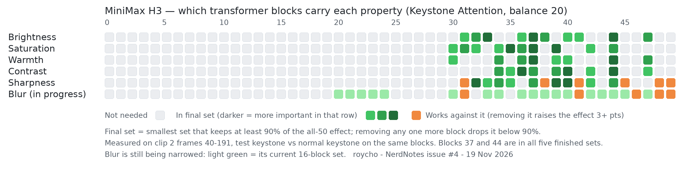

# Test 21: which blocks carry each picture property

Follow-up to [test 19](../20261113/attention_sweep.md) and [test 20](../20261115/keystone_attention_motion_and_hybrid.md). Test 19 found the brightness blocks. This test maps the other properties a keystone can pass into new frames, one at a time, and re-runs brightness with a stricter control. Started in [issue #4](https://github.com/roycho87/NerdNotes/issues/4).

*Green = in the final set for that property (darker = bigger loss when removed). Orange = works against it (removing it raises the effect by 3 points or more). Blur is still being narrowed; light green is its current 16-block set.*

## Short version

1. **Blocks 0–29 do nothing** for any property, beyond what the keystone does with the node off.
2. **30–39 carries most of it, 40–49 a smaller share.** Warmth leans on 40–49 more than the others, and blur sits later still.
3. **Blocks only work together.** Each half is small on its own, and the full effect only shows up when they're combined. Sharpness shows it most: 30–39 and 40–49 add up to 64% apart, but give 111% together.
4. **Blocks 37 and 44 are in all five finished sets.** 36 is in four.
5. **Some blocks work against sharpness and blur.** Taking 48, 49, 38 and 31 out of 30–49 gives **139%** of the all-50 sharpening. Brightness, saturation, warmth and contrast have no blocks like that.
6. **Test 19's numbers read 3 to 4 points high** (see the correction below). The shape and the block list it found still hold.

## Setup

* **Node:** Geiru Keystone Attention, `block_mode` custom blocks, `balance` 20, `take_from` context slice.
* **Render:** clip 2 only, always from the same clip 1. 192 frames, 39 held from clip 1 (22 kept, 17 freed), seed 1234, 8 steps, the 8-step ref2v turbo LoRA. No other LoRAs.
* **Repeatable:** the same settings give a byte-identical video, so each setting got one run.

## Method

1. **Test keystones:** clip 1's first frame with one property pushed and the rest held:
   * Brightness ×1.3
   * Saturation ×1.5, brightness held
   * Warm tint: red ×1.08, blue ×0.88
   * Contrast ×1.3 on brightness only
   * Sharpened (unsharp mask)
   * Blurred (2 px Gaussian)
2. **Control:** every block set is also rendered with the **normal keystone on the same blocks**. The lift is the test keystone minus the normal one, measured on clip 2's new frames (40–191).
3. **Group sweep:** none, 0–9, 10–19, 20–29, 30–39, 40–49, 30–49, all 50, then the halves 30–34, 35–39, 40–44 and 45–49.
4. **Whittling:** the pass mark is **90% of the all-50 lift**, fixed for each property. Starting from the smallest group set that passes, each block is removed on its own, then the least important are removed together two at a time to find where it breaks, then each block is removed on its own again until no single removal passes.
5. **Measured with:** mean luma (brightness), mean HSV saturation, mean Lab b* (warmth), luma standard deviation (contrast), Laplacian variance (sharpness and blur).

## Final block sets

| Property | Blocks | Count | Share of the all-50 effect |
|---|---|---|---|
| Brightness | `31-33, 36-38, 40-41, 44, 47` | 10 | 93% |
| Saturation | `30-32, 34-37, 39, 42, 44` | 10 | 95% |
| Warmth | `30, 34, 36-37, 39-40, 44, 47` | 8 | 92% |
| Contrast | `34-37, 39-40, 42, 44, 47` | 9 | 91% |
| Sharpness | `32-35, 37, 39-40, 42, 44` | 9 | 92% |
| Blur | `20-24, 30, 33-34, 36-40, 42-45, 47` (in progress) | 16 | 104% |

In every finished set, removing any one more block drops it below 90%.

The suite's "lighting blocks" default is still test 19's 13 blocks (`31-33, 36-44, 47`). With this round's method they give 103% of the all-50 brightness, so they still work; the 10-block set is just the smallest one that passes.

## Group sweeps

Share of the all-50 effect (100% = all 50 blocks at balance 20):

| Blocks | Brightness | Saturation | Warmth | Contrast | Sharpness | Blur |
|---|---|---|---|---|---|---|
| none (node off) | 5% | 7% | 4% | 10% | 2% | 6% |
| 0–9 | 6% | 9% | 5% | 14% | 2% | 12% |
| 10–19 | 5% | 7% | 6% | 13% | 1% | 8% |
| 20–29 | 8% | 11% | 6% | 21% | 7% | 9% |
| 30–39 | 71% | 91% | 84% | 85% | 54% | 38% |
| 40–49 | 29% | 38% | 63% | 52% | 10% | 44% |
| 30–49 | 109% | 97% | 101% | 102% | 111% | 87% |
| 30–34 | 24% | 29% | 34% | 59% | 19% | 13% |
| 35–39 | 35% | 42% | 49% | 69% | 17% | 32% |
| 40–44 | 26% | 26% | 29% | 51% | 18% | 44% |
| 45–49 | 4% | 12% | 10% | 7% | −12% | −2% |

Size of the all-50 effect:

| Property | All-50 lift |
|---|---|
| Brightness | +18.5% |
| Saturation | +36.3% |
| Warmth | +7.5 b* |
| Contrast | +18.6% |
| Sharpness | +56.7% |
| Blur | −43.6% |

* 30–49 beats all 50 for brightness (109%) and sharpness (111%), so 0–29 as a group seems to work slightly against those two.
* Blur is the odd one out: 30–49 only reaches 87%. Adding any 10 early blocks (0–9, 10–19 or 20–29) pushes it over 90%, so the early part looks like "more blocks attending" rather than anything specific to those blocks.

## Blocks that work against it

Each block was removed from its own starting set and compared with that set. A block counts as working against the property if removing it raises the effect by 3 points or more.

| Property | Blocks (points gained when removed) |
|---|---|
| Sharpness (from 30–49) | 48 (+22), 49 (+6), 38 (+6), 31 (+5), 45 (+5), 41 (+3) |
| Blur (from 20–49) | 49 (+14), 41 (+11), 46 (+7), 31 (+4), 48 (+3) |
| Brightness, saturation, warmth, contrast | none (nothing above +2, inside run-to-run spread) |

* **Strongest sharpening set so far:** 30–49 without 48, 49, 38 and 31 (`30, 32-37, 39-47`) gives **139%** of the all-50 sharpening.
* Dropping 49, 41 and 46 from 20–49 takes blur from 91% to 120%.
* 45–49 as a group softens the picture on its own (−12% on the sharpened keystone).

## Side effects at the final sets

| Test keystone | What else changed |
|---|---|
| Saturated | about 5% darker |
| Warm | saturation +9%, about 2% darker, slightly redder (a* +1.3) |
| Sharpened | about 2% darker; contrast and saturation unchanged |

## Correction to test 19

Two things in test 19's block sweep differ from this round:

1. **The comparison clip.** Every row in test 19's group sweep was compared with one fixed clip: the normal keystone with balance 20 on **all 50 blocks**. Balance on its own darkens a clip a little (here up to 3%), so every test 19 row reads 3 to 4 points high. This round compares each block set with the normal keystone on the **same** blocks.
2. **An extra LoRA** was on during test 19. It's off for this round.

Brightness lift, brightened keystone:

| Blocks | Test 19 | This round |
|---|---|---|
| none | +4.4% | +0.9% |
| 0–9 | +4.2% | +1.1% |
| 10–19 | +4.0% | +0.9% |
| 20–29 | +4.1% | +1.4% |
| 30–39 | +13.8% | +13.2% |
| 40–49 | +7.0% | +5.4% |
| 30–49 | +19.0% | +20.2% |
| all 50 | +18.1% | +18.5% |

The shape doesn't change, and the LoRA barely moves where brightness sits. Test 19's 13 blocks still hold.

## Other repeats

* **Dylan (matlowai)** repeated the group sweep independently, with his own reference picture, clip 1 and turbo LoRA, and the same same-block control ([his write-up](https://github.com/roycho87/NerdNotes/issues/4#issuecomment-6979460344)). Same shape on brightness, saturation, contrast, sharpness and warmth: 30–39 +12 to +16% brightness, 40–49 about +3.4%, 0–29 nothing. He also found that single blocks do almost nothing alone and that balance levels off around 10. Inside 30–39 for brightness we agree on 33, 36, 37 and 38 in and 30 and 34 out; I have 31 and 32 in, he has 35 and 39 (one seed each, different picture and LoRA).
* **dkackman's diffusers-workflow** reimplemented the attention op in diffusers and ran the brightened keystone on a narrated chain ([issue #1394](https://github.com/dkackman/diffusers-workflow/issues/1394)). Against a normal keystone with no balance: no balance +0.13%, 0–29 +0.57%, 30–39 +8.39%. Same shape, so the block numbers line up between diffusers and ComfyUI.

## Known problems

* **NaN audio bug:** some runs crash at video save (ffmpeg: audio "contains NaN/Inf"), or save a black 9 KB video while still reporting success. It repeats for certain block sets (for example 30–49 without 41 on the saturated, contrast and warm keystones). Those single-removal results are missing; each final set was checked directly.
* **Node updates during the run:** Keystone Attention's speed update on 17 Nov shifted one check run by 0.3 points (35.8% → 35.5%). The later `take_from` and sparse updates gave byte-identical output.

## Still to do

* **Blur:** finish narrowing the 16-block set.
* **Which early group** works slightly against brightness and sharpness (bright and sharp keystones on 0–9 + 30–49, 10–19 + 30–49 and 20–49).
* **Composition:** a 5% zoom keystone.
* **Motion:** raise balance on all 50 until motion stops, then sweep the groups at that balance.
* **10-clip chain checks** and side-by-side videos for each final set.
