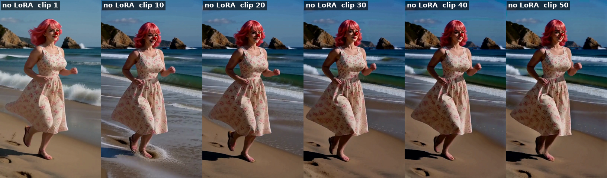

# NerdNotes

**roycho's lab notebook for MiniMax H3 long-video experiments.**

Why do long H3 videos fall apart, and how do you stop it? These are the dated notes from working that out: the setup, prompts, settings and results for every test, side-by-sides, and the experiments that didn't work alongside the ones that did. The nodes that came out of it are in the **[Geiru Context Suite](https://github.com/roycho87/geiru_context_suite)**.

*50 clips (about 5 minutes 20 seconds stitched) of one continuous beach scene with degradation protection on: clips 1, 10, 20, 30, 40 and 50.*

The pink-haired clown is the test subject. She's in almost every test on purpose: the same face, hair and dress in every clip makes drift easy to spot.

## Start here

**[Frame 0 conclusions](20261101/frame0_conclusions.md)** is the summary of what's been found so far. In short:

1. **Frame 0 matters most.** H3 leans hardest on a clip's first frame. In a chain, each clip's frame 0 comes from partway through the clip before, so it carries all the drift so far and passes it forward.
2. **The keystone fixes that.** Locking clip 1's clean first frame into every shot pulls each one back toward the start, so the drift can't stack up.
3. **The capstone helps more, but only late.** Adding clip 1's last frame to the back cuts drift further, but locked from the start it drags her pose. Late Lock brings it in for just the last steps.
4. **Context noise works best at linear, strength 1** (ethanfel's idea).
5. **Scene changes reset drift on their own,** so protection is a switch: on for long single-scene stretches, off around cuts.
6. **It holds over long chains.** 50 clips stay clean where a plain chain falls apart. What's left is a small, steady darkening that stops a little below clip 1.
7. **The Anti-Burn LoRA** (Imagineer13) has a positive impact on colour on its own, but on top of degradation protection it made no visible difference, on a still scene or over 50 clips of a moving one. The earlier colour gain couldn't be replicated (suspected cause: double compression of one of the initial side-by-sides). Geiru Protection LoRA is now [experimental](https://github.com/roycho87/Geiru-Protection-LoRa-Experimental).
8. **Hybrid Windows held for two minutes** in one render, with no visible degradation. At full steps it's not as good as the continuation nodes at preventing degradation ([test 15](20261106/talking_clown_hybrid_16win.md): no visible change, but a slow measured darkening), and that isn't its purpose: it's for fast, seamless motion.
9. **Your speed (turbo) LoRA matters:** protection that works with one turbo may not with another.

## All the notes

| Date | Page | What's in it |
|---|---|---|
| 2026-10-31 | [Long-video experiments](20261031/h3_long_video_experiments.md) | What worked and what didn't for long H3 videos, before the frame 0 work. |
| 2026-11-01 | [Frame 0 conclusions](20261101/frame0_conclusions.md) | The running summary, sections 1–11: frame 0, keystone, capstone, context noise, the 50-clip beach benchmark and the context noise sweep. |
| 2026-11-01 | [Frame 0 influence test](20261101/frame0_influence_test.md) | The test plan: the frame 0 grid, chains and the later held-frame tests. |
| 2026-11-02 | [How latents work, and where degradation comes from](20261102/h3_latents_and_degradation.md) | What an H3 latent is, and why chaining clips makes quality drift. |
| 2026-11-04 | [Anti-Burn LoRA results](20261104/antiburn_results.md) | Burn and colour with and without the LoRA (tests 11 and 12). |
| 2026-11-04 | [Hybrid Windows: 2 minutes in one render](20261104/hybrid_windows_2min.md) | A 16-window, 2-minute roller coaster ride, and the prompt fixes that made the joins hold. |
| 2026-11-04 | [Test 13: LoRA strength on a still scene](20261104/static_chair_lora_test.md) | No LoRA, 0.2, 0.4 and 0.6 over 30 clips. |
| 2026-11-05 | [Test 14: LoRA strength on a moving scene](20261105/beach_lora_strength_test.md) | The same four strengths over 50 clips of the beach: no visible difference. |
| 2026-11-06 | [Test 15: a talking clown in 16 Hybrid Windows](20261106/talking_clown_hybrid_16win.md) | 2 minutes of talking at full steps: no visible degradation, a slow measured darkening, and the prompting fixes. |
| 2026-11-07 | [Test 16: every combination of the three protections](20261107/beach30_protection_combos.md) | Eight 30-clip beach chains, every combination of keystone + capstone, the protection LoRA and context noise. Keystone + capstone does almost all the work: it halves the colour drift and darkening; the others only trim fine grain. |
| 2026-11-07 | [Test 17: the protections again on a forest trail](20261107/forest30_protection_combos.md) | Context only and the four keystone runs, new scene and seed. Same result as test 16: keystone + capstone stops the drift; context noise and the LoRA add little or nothing visible on top. |
| 2026-11-08 | [Related research: matlowai's h3-long-video-research](community_cc_by_sa/matlowai_h3_long_video_research.md) | Dylan (matlowai) measured the suite on 2-minute chains: keystone + capstone holds (even every 3rd clip), the LoRA, context noise and Late Lock add nothing, and the audio drone comes from the audio carry. |
| | [Next tests](20261104/next_tests.md) | What's coming up. |

**From the community:** [Imagineer13 on how the Anti-Burn LoRA was made](community_cc_by_sa/Imagineer13_H3_antiburn_notes.md) · [NikoDemon80's drift notes](community_cc_by_sa/NikoDemon80_H3_drift_notes.md) · [Dylan (matlowai)'s long-video research](community_cc_by_sa/matlowai_h3_long_video_research.md)

## Credits

This builds on a lot of other people's work: seitanism and NikoDemon80 (H3 Motion Context), ethanfel / Lumifel (context noise), drozbay (masked extension), kijai (H3 support and context windows), JalenBrunson (HybridWindows), TrentHunter82 (the degrade node), Imagineer13 (the Anti-Burn LoRA), and everyone on the Banodoco Discord and r/StableDiffusion who tested and argued. Full credits are in the [Geiru Context Suite README](https://github.com/roycho87/geiru_context_suite#credits).

## Contributing

Found something, ran a test, or wrote up your own results? Open an [issue](https://github.com/roycho87/NerdNotes/issues).

**If you want your contribution protected by the CC BY-SA 4.0 license, to keep it open source, you must say so in your issue,** and I'll add it to the protected folder, [`community_cc_by_sa/`](community_cc_by_sa/). Anyone who reuses a protected contribution must credit its contributor as well as NerdNotes. Otherwise it goes into a community folder that isn't covered by the license (like [`20261102/community/`](20261102/community/)).

## License

NerdNotes is licensed under [CC BY-SA 4.0](LICENSE): share and adapt anything here, as long as you credit roycho / NerdNotes with a link back and share what you make under the same license. Contributions in `community_cc_by_sa/` are under the same license, and reusing them requires crediting their contributor too. The other community folders aren't covered. Details in [NOTICE.md](NOTICE.md).
